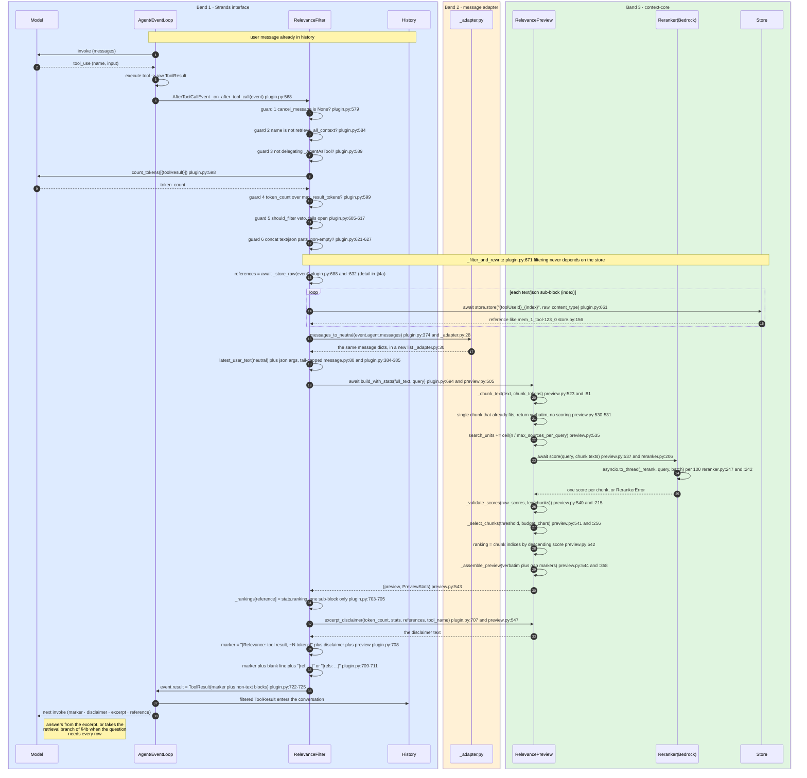
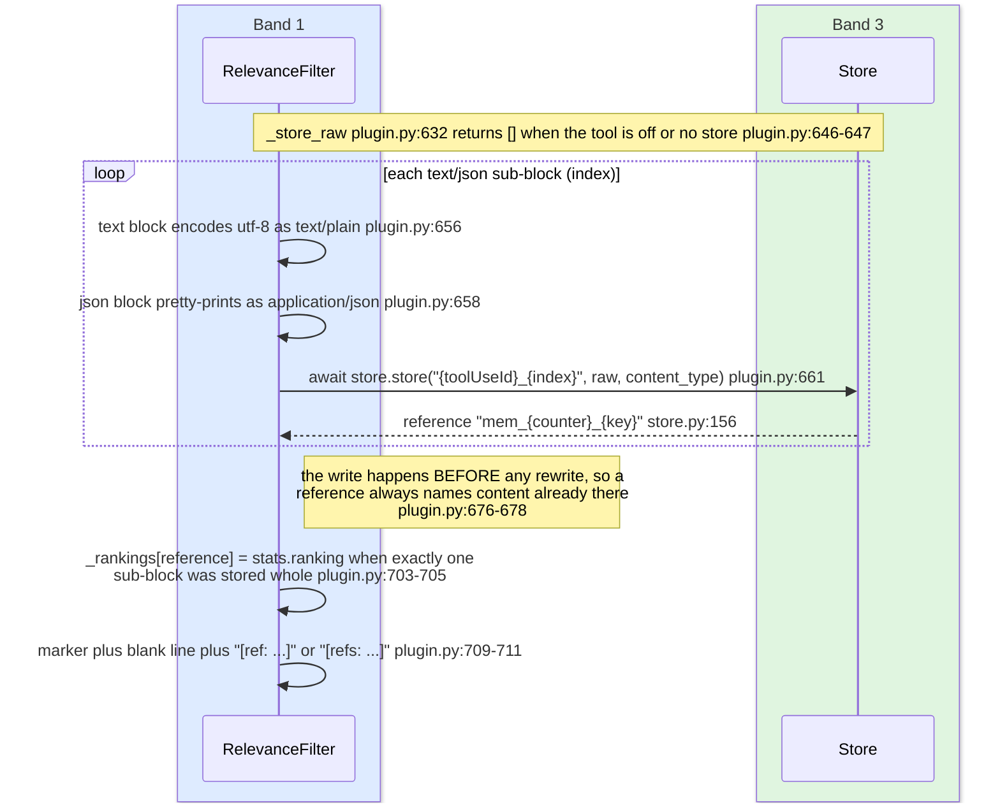
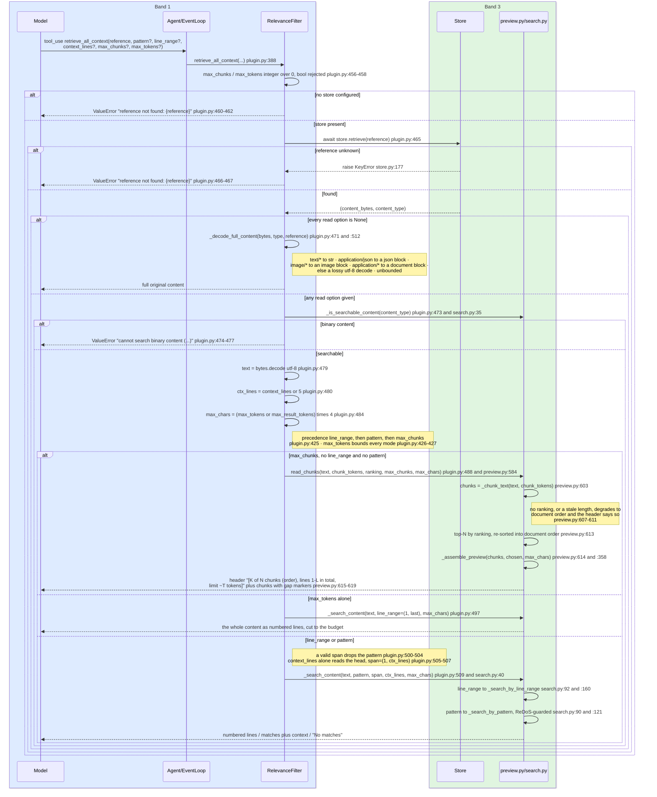
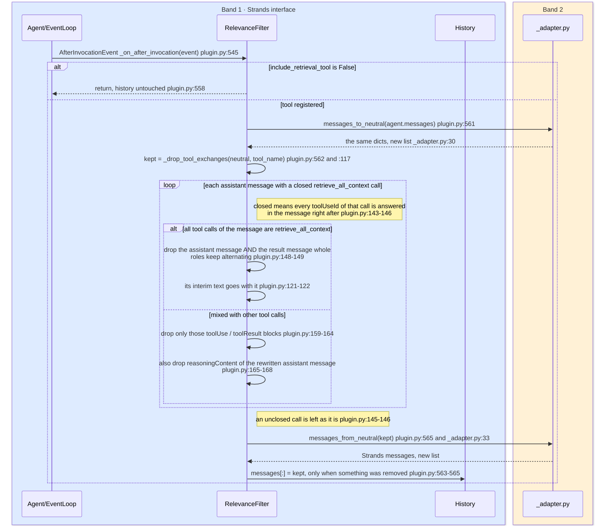

# Practice A — `strands-relevance-filter`: Sequence & Integration Design

All line references are into one of three trees, named per reference:

| Band | Tree | Files |
|------|------|-------|
| **1. Strands interface** | `strands-community-plugins/strands-relevance-filter/src/strands_relevance_filter/` | `plugin.py`, `_compat.py` |
| **2. Message adapter** | the same package | `_adapter.py` |
| **3. `context-core`** | `context-core/src/context_core/` | `message.py`, and under `relevance/` the modules cited by their bare names — `preview.py`, `search.py`, `store.py`, `reranker.py` |

§8 references `validation/community-plugin-A-B-D/src/` (`runner.py`, `config.py`).

> **The three-band split is what this package now is.** Every decision about *content* — chunking,
> scoring, threshold-and-budget selection, verbatim assembly, the disclaimer text, the offload
> backends, the retrieval search — lives in `context_core.relevance`, which imports no agent
> framework (`message.py:3`). What stays here is the Strands attachment surface and the model-facing
> plumbing around it. The package docstring says so (`__init__.py:14-16`).
>
> **Band 2 is a cast, not a conversion.** The neutral shape was modeled on the Strands SDK's own
> message dicts (`message.py:20-21`), so a Strands `Message` already *is* a `NeutralMessage` and a
> `ToolResult` already *is* the body of a neutral `toolResult` block. `_adapter.py` exists to make
> that identity explicit and to guarantee the two properties the core relies on: unknown blocks pass
> through untouched, and nothing is mutated — the lists it returns are new (`_adapter.py:6-10`).
>
> **Default mode.** `include_retrieval_tool` defaults to **`True`** (`plugin.py:271`).
> In the default configuration the turn is `llm -> tool -> filtered result (+ disclaimer + reference)
> -> llm`, with a retrieval branch the model may take when the question needs the whole result. The
> store is written, a `[ref: ...]` token is emitted, and `retrieve_all_context` stays registered
> (`plugin.py:388`). Passing `include_retrieval_tool=False` is the **opt-out**: no store, no
> reference token, no tool (`plugin.py:322-325`).
>
> **What a retrieval costs is bounded to one turn.** A closed `retrieve_all_context` exchange is
> removed from `agent.messages` when the invocation ends (`_on_after_invocation`, `plugin.py:545`), so
> a read back is paid for in the turn that asked for it and not re-sent on every later call.
>
> **Storage never gates filtering.** Chunking, reranking, selection and the rewrite of `event.result`
> run identically with or without a store (`_filter_and_rewrite`, `plugin.py:671`). The store is a
> step that runs first (`_store_raw`, `plugin.py:632`) and exists only to serve
> `retrieve_all_context`.

---

## 1. What the plugin does, mechanically

The plugin registers **two** SDK hooks — `AfterToolCallEvent` (`plugin.py:568`, decorated at
`plugin.py:567`) and `AfterInvocationEvent` (`plugin.py:545`, decorated at `plugin.py:544`) — and one
`@tool`, `retrieve_all_context` (`plugin.py:388`), which is registered unless the caller opts out.
Both SDK symbols arrive through the one-file compatibility shim `_compat.py` (`_compat.py:13-16`),
which the rest of the package imports instead of `strands` directly (`_compat.py:3-4`).

After any tool call completes, the first hook wraps the result as a message and asks the agent's own
model to count its tokens (`plugin.py:598`); if the count exceeds `max_result_tokens` (default 8,000)
and six guards pass, it concatenates the scorable text (`plugin.py:621-626`) and hands it to the core:
chunk, score against a query built from the newest user question plus the tool-call arguments
(`_build_query`, `plugin.py:353`, read at `plugin.py:692`), select the highest-scoring verbatim chunks
that fit a `preview_tokens` budget, assemble them with gap markers — all of it inside
`build_with_stats` (`preview.py:505`). The hook then overwrites `event.result` in place
(`plugin.py:725`). Selection is verbatim — chosen chunks are exact substrings of the source
(`_select_chunks`, `preview.py:256`; assembly at `preview.py:358`) — so numbers, currency and tables
stay exact.

**Three things travel with the excerpt.** The rewritten text is a marker, a **disclaimer**, the
verbatim preview, and a reference token (`plugin.py:707-711`). The disclaimer is built by the core
from the `PreviewStats` the selection returned (`excerpt_disclaimer`, `preview.py:547`; called at
`plugin.py:707`) and states how much of the result is on screen, that an answer needing every row
cannot be computed from it, and — with the tool registered — the call and the budgets that reach the
rest (`preview.py:566-582`).

**Default mode (tool on).** `_store_raw` writes each scorable (`text`/`json`) sub-block of the result
verbatim into the bound `store` (`plugin.py:661`) before anything is rewritten, so a reference always
names content that is already there. When exactly one scorable sub-block was stored whole, the chunk
ranking is memoized against its reference (`self._rankings`, `plugin.py:705`) so a later `max_chunks`
read needs no second scoring call. The marker then gains a trailing `[ref: ...]`/`[refs: ...]` token
(`plugin.py:709-711`) the model passes back to `retrieve_all_context` to load the whole result by
span, pattern, chunk count or token budget.

**Opt-out mode (`include_retrieval_tool=False`).** `_store_raw` returns an empty list at once
(`plugin.py:646-647`) — no store is even built (`plugin.py:318`) — so `references` is empty, the
`if references:` branch that appends the reference token never runs (`plugin.py:709`), the tool is
dropped from `_tools` at bind time (`plugin.py:322-325`), and `_on_after_invocation`
(`plugin.py:545`) returns before touching the history (`plugin.py:558`). The disclaimer takes its
other branch and tells the model to say the result was filtered rather than aggregate the excerpt
(`preview.py:572-573`). Filtering itself is unaffected. This mode measures **preview quality alone**:
one filtered result against the model's answer, with no recovery cycle to rescue a bad cut.

---

## 2. Integration table — every SDK attachment point

The plugin attaches to the Strands SDK **public extension surface only**. It subclasses
`strands.plugins.Plugin` — `class RelevanceFilter` (`plugin.py:220`), imported through the shim
(`_compat.py:15`). The base `Plugin.__init__` scans the instance for `@hook`- and `@tool`-decorated
methods, and that scan is invoked **last** in the constructor (`plugin.py:304`) so it sees the fully
built instance.

| # | Attachment | Registered at | Mechanism / order | Reads | Mutates |
|---|-----------|---------------|-------------------|-------|---------|
| 1 | `AfterToolCallEvent` handler — `_on_after_tool_call` | `plugin.py:568`, decorated at `plugin.py:567` | Subscribed via `@hook`; the event type is inferred from the handler's type hint resolved at decoration time, which is why the shim imports the event at runtime (`_compat.py:11-14`). **No explicit `order` value is set** — a bare `@hook` with no arguments. | `cancel_message` (`plugin.py:579`); `tool_use` name (`plugin.py:584`), `toolUseId` (`plugin.py:593`), `input` (`plugin.py:377`); `selected_tool` plus `.delegate` (`plugin.py:589`); `result` (`plugin.py:592`); `agent.messages` through the adapter (`plugin.py:374`); `count_tokens` (`plugin.py:598`) | `event.result` — reassigned to a new `ToolResult` (`plugin.py:725`). The docstring states this is the only field ever written — `result` (`plugin.py:576`). |
| 2 | `AfterInvocationEvent` handler — `_on_after_invocation` | `plugin.py:545`, decorated at `plugin.py:544` | Subscribed via the same bare `@hook`; `AfterInvocationEvent` is imported at runtime for that inference (`_compat.py:14`). Fires when the invocation ends, which is **before** the next user message closes the turn. | `self._include_retrieval_tool` (`plugin.py:558`); `event.agent.messages` (`plugin.py:560`); `retrieve_all_context.tool_name` (`plugin.py:562`) | `agent.messages` **in place** — `messages[:] = messages_from_neutral(kept)` (`plugin.py:565`), the new list built by the core-shaped `_drop_tool_exchanges` (`plugin.py:117`). Nothing else. |
| 3 | `retrieve_all_context` tool — registered by default | `plugin.py:388`, decorated `@tool(context=True)` at `plugin.py:387` | Auto-discovered into `self._tools` by the base `Plugin` scan, and **removed again** in `init_agent` only when `include_retrieval_tool=False` (`plugin.py:322-325`). `context=True` injects `tool_context: ToolContext` (`plugin.py:391`). | `reference`/`pattern`/`line_range`/`context_lines`/`max_chunks`/`max_tokens`; the bound `store` (`plugin.py:460`); `_max_result_tokens` (`plugin.py:484`); `self._rankings` (`plugin.py:491`). | Nothing in history or state. Returns content to the model; does **not** write `event.result` or the store. |

**Conditional de-registration is the opt-out path.** `init_agent` drops the auto-discovered tool by
matching `retrieval_tool_name` (`plugin.py:324`) and rebuilding `_tools` without it
(`plugin.py:325`). Because `include_retrieval_tool` defaults to `True` (`plugin.py:271`), attachment
#3 is present unless the caller explicitly asks for it to go.

`init_agent` (`plugin.py:306`) is the SDK bind callback: it lazily creates the default `InMemoryStore`
(`plugin.py:318-319`) when the retrieval tool is on and no store was supplied, and for an
`InMemoryStore` it `_bind`s it to `id(agent)` (`plugin.py:321`, store `_bind` at `store.py:182`). It
does **not** register additional hooks or events. In the opt-out no store is constructed at all — the
filter does not need one (`plugin.py:646`).

In the default configuration there are exactly **two** callbacks registered (both hooks) plus one
tool. No `MessageAddedEvent`, no `InvokeModelStage` handler, no middleware stage, and no system-prompt
writer is registered anywhere in the source.

**Construction is inert** (`plugin.py:231-233`). `__init__` (`plugin.py:265`) validates
`max_result_tokens > 0` (`plugin.py:290-291`) and builds no `Reranker` and no `RelevancePreview` —
those are created on the first scoring call (`_resolve_preview`, `plugin.py:327`, guarded at
`plugin.py:342`), so a plugin that never fires needs no AWS credentials merely to be declared
(`plugin.py:330-332`).

---

## 3. Sequence diagram — one full turn, DEFAULT mode, across the three bands

The `box` groupings are the bands: what is Strands-specific, what is the adapter, and what is core.
Every step inside band 3 is shared with any other binding of Practice A. The store write runs before
the rewrite, the disclaimer is composed from what the selection did, and the reference token closes
the marker. The retrieval branch the model may take from here is §4b, and its removal from the
history is §4c.



Failure short-circuits that leave the raw result in history unchanged:

- `RerankerError` from `build_with_stats` → logged at debug, original kept, never re-scored
  (`plugin.py:695-699`). The error is the core's (`reranker.py:57`), raised for an empty query
  (`reranker.py:233`), a transport failure (`reranker.py:251-253`) or a malformed response
  (`reranker.py:256`).
- A store write raising → caught by `except Exception`, logged as a warning, `None` returned
  (`plugin.py:662-668`), which `_filter_and_rewrite` turns into an early exit
  (`plugin.py:688-690`). A reference is never handed out for content that is not there. In the
  opt-out this path is unreachable because nothing is stored.

**Opt-out mode** removes three steps from the diagram and changes one: the `_store_raw` loop does not
run (`plugin.py:646-647`), the `[ref: ...]` line is skipped (`plugin.py:709`), no ranking is memoized
(`plugin.py:704`), and the disclaimer takes its no-reference branch (`preview.py:572-573`).
Everything between `_filter_and_rewrite` and `event.result` is identical.

### 3a. What each band owns

| Step | Band | Why it sits there |
|------|------|-------------------|
| The two `@hook` handlers, the six guards, `init_agent`, the `@tool` registration and de-registration | 1 | Pure Strands attachment. `AfterToolCallEvent`, `AfterInvocationEvent`, `Plugin`, `hook`, `tool`, `ToolContext`, `ToolResult`, `ToolResultContent` and the private `_AgentAsTool` are the only framework symbols used, and all of them come from `_compat.py` (`_compat.py:30-40`). |
| `messages_to_neutral`, `messages_from_neutral` | 2 | The only module that names both `strands` types and `context_core.message` (`_adapter.py:12`). Because the neutral shape mirrors the SDK's, both are casts over the same dicts (`_adapter.py:30`, `_adapter.py:35`) — a new list each time, so the result can be assigned back onto a live `agent.messages` without aliasing the input (`_adapter.py:9-10`). |
| Marker, reference token, `event.result` rewrite, history surgery | 1 | The model-facing *text* assembly and the SDK-shaped mutation are binding concerns. `_drop_tool_exchanges` (`plugin.py:117`) reads the neutral shape but is the binding's own, because what counts as a closed exchange is a history-surgery decision. |
| `_chunk_text`, `score`, `_validate_scores`, `_select_chunks`, `_assemble_preview`, `PreviewStats`, `excerpt_disclaimer`, `read_chunks` | 3 | Every decision about *content*, and the disclaimer prose that reports it. Framework-agnostic by construction — plain strings and dataclasses. |
| `Store` / `InMemoryStore` / `FileStore` / `S3Store`, `_search_content`, `_is_searchable_content` | 3 | Offload backends and retrieval search helpers (`relevance/__init__.py:3-7`). |
| `latest_user_text` | 3 | Operates on the neutral shape, so the binding converts first (`message.py:80`, called at `plugin.py:374`). |

Two core privates are imported directly because re-deriving them in the binding would be a second
implementation of core logic: `_is_searchable_content` and `_search_content` (`plugin.py:24`), used
by the retrieval tool at `plugin.py:473` and `plugin.py:509`.

### 3b. The adapter is a cast, and what that costs

`messages_to_neutral` and `messages_from_neutral` perform no copy of any message and no translation of
any block: they rebuild the *list* and hand the same dicts over (`_adapter.py:30`, `_adapter.py:35`).
Two consequences worth naming:

- **Reading a list back is one-to-one.** Unlike the LangGraph binding, there is no case where one
  neutral message stands for several framework messages, so `_drop_tool_exchanges` can work on
  positions — an assistant message and the user message right after it (`plugin.py:143-149`) — and
  the result can be assigned straight back (`plugin.py:565`).
- **The core can see blocks it does not recognise, and ignores them.** `reasoningContent`, `image`,
  `document` and `cachePoint` blocks, and message-level keys such as `metadata`, stay in place
  (`_adapter.py:6-8`).

`_adapter.py` also declares `result_to_neutral` (`_adapter.py:38`) and `result_from_neutral`
(`_adapter.py:43`) for a binding that needs to name a tool result as a neutral block. This plugin does
not import them (`plugin.py:26`): it reads `event.result["content"]` directly (`plugin.py:652`,
`plugin.py:685`), because a Strands `ToolResult` already *is* that block's body.

---

## 4. The retrieval path — `retrieve_all_context`

The tool loads the **whole** of a result the filter cut to an excerpt, for the one question an excerpt
cannot answer: a maximum, minimum, total, count, average, ranking or any comparison across all of it
(docstring `plugin.py:398-402`). Reading a passage the excerpt already shows is explicitly not its
job.

### 4a. The store write inside the turn of §3



The ranking is memoized only for a reference holding exactly the text that was chunked — one
scorable sub-block, stored whole — because the indices index chunks of `full_text`
(`plugin.py:701-702`).

### 4b. The retrieval round trip, and the budgets on it



Notes read from source:

- **Default budget.** With no `max_tokens`, a read is bounded by `max_result_tokens * 4` chars —
  `max_chars` (`plugin.py:484`) — the same threshold that made the result oversized, so reading back
  never costs more context than the original would have (`plugin.py:481-483`). `max_tokens` is the
  model's explicit choice to pay for more, and it bounds **every** mode (`plugin.py:426-427`). A full
  read with no options at all is the one unbounded path (`plugin.py:470-471`).
- **`max_chunks` reuses the filter's own ranking, in the core.** `read_chunks` (`preview.py:584`)
  re-chunks the stored text with the same `chunk_tokens` the plugin passes in (`plugin.py:490`) and
  reads the ranking memoized at filter time (`plugin.py:491`); a missing ranking, or one whose length
  no longer matches, degrades to document order and the header says so (`preview.py:607-611`). The
  chosen chunks are rendered in **document order** with a gap marker for every omitted span
  (`preview.py:613-614`), so a `max_chunks` at least the chunk count returns the whole result.
- **Argument validation runs before the store is touched.** A `max_chunks`/`max_tokens` that is not an
  integer ≥ 1 — `bool` included, since `True` would pass as `1` — raises `ValueError`
  (`plugin.py:456-458`).
- **A missing store is a missing reference, not a crash.** With `include_retrieval_tool=True` the
  store always exists (`plugin.py:318-319`), so `plugin.py:460-462` is reached only when a caller
  supplies no store while keeping the tool on.
- `line_range` precedence: a valid span drops the `pattern` (`plugin.py:504`, reason at
  `plugin.py:502-503`); an `end` past the last line is **clamped** by `scope_end` (`search.py:84`),
  not rejected; a bad `start` (<1, >`end`, or >`total_lines`) raises `ValueError` (`search.py:78`,
  `search.py:80`, `search.py:82`).
- Pattern search caps pattern length at `_MAX_PATTERN_LENGTH` = 200 chars (`search.py:15`, applied at
  `search.py:131`) and rejects a nested-quantifier heuristic, `_NESTED_QUANTIFIER` (`search.py:17`,
  checked at `search.py:134`), falling back to an escaped literal on any `re.error`
  (`search.py:137-138`).

### 4c. End of the invocation — the retrieval exchange leaves the history

A retrieval is for the answer in flight. Kept, its result — possibly the whole of a large tool result
— would ride along on every later model call and be read by a context graph as evidence of the turn.
The second hook removes it at the end of the invocation, which is **before** the next user message
closes the turn, so a graph deriving that turn's Card never sees it (`plugin.py:548-553`). What stays
is the excerpt with its reference, so the content is still retrievable later, and the answer, which
carries the figures the retrieval served — which is why the tool description tells the model to state
them (`plugin.py:417-418`).



`_drop_tool_exchanges` returns `messages` itself when nothing matched (`plugin.py:151-152`), and the
hook compares by identity before writing (`plugin.py:563`), so a turn with no retrieval leaves the
list object untouched.

---

## 5. Expected model behaviour and where the assumption can fail

### 5a. Default mode — five assumptions

1. **Reads the `[Relevance: ...]` marker and the disclaimer as a signal that content was replaced.**
   The marker text (`plugin.py:708`) is the cue and the disclaimer is the instruction
   (`preview.py:565-582`). *Fails if:* the model ignores both and treats the excerpt as the complete
   tool output — it then answers from a partial view.
2. **Does not aggregate over the excerpt.** The disclaimer names the categories that cannot be
   computed from it — maximum, minimum, total, count, average, ranking, any comparison across the
   whole result (`preview.py:569-570`). *Fails if:* the model computes the aggregate anyway and is
   confidently wrong, which is the failure the disclaimer exists to prevent (`preview.py:550-552`).
3. **Trusts the verbatim excerpt for the on-target passages.** Selection keeps the highest-scoring
   chunks — `_select_chunks` (`preview.py:256`). *Fails if:* the reranker mis-scored (wrong query,
   poor model), so the needed passage scored below `relevance_threshold` and was cut. There is an
   empty-selection guard that keeps the best chunk anyway when no candidate clears the threshold
   (`preview.py:303-305`), but "best" may still be wrong.
4. **Notices the gap markers and the trailing `[ref: ...]`/`[refs: ...]` token, and calls
   `retrieve_all_context` with that exact reference.** These are the affordances telling the model
   there is more and how to reach it (`_format_gap_marker`, `preview.py:326`; token built at
   `plugin.py:710`; the disclaimer names the call and the reference at `preview.py:576-577`).
   *Fails if:* the model does not parse the reference token, or fabricates one that was never issued
   (→ `ValueError` "reference not found", `plugin.py:467`); or it reaches for the tool to re-read a
   passage the excerpt already shows, which the description tells it not to do (`plugin.py:402`).
5. **States the figures it relied on in the answer.** The retrieved exchange is removed when the
   invocation ends (`plugin.py:545`), so a figure that lives only in the tool result is gone from the
   next turn. Both the disclaimer (`preview.py:580-581`) and the tool description
   (`plugin.py:417-418`) say so. *Fails if:* the model answers by pointing at the retrieved block
   instead of restating the number, and a later turn asks a follow-up about it.

A model that turns a gap marker's omitted-line count into a follow-up `line_range` is on supported
ground — the description promises the marker's line numbers match retrieval's (`plugin.py:423-424`).
*It surprises if:* the trailing gap marker over-reports — a truncation inside the first line of the
last chunk makes `first_unshown_line` that line itself (`preview.py:353`), so `_trailing_gap_marker`
reports every source line as omitted (documented at `preview.py:337-343`); the count is a safe
**lower bound**, not an exact tally.

### 5b. Opt-out mode — one assumption replaces four

With `include_retrieval_tool=False` assumptions 4 and 5 are moot and 1–3 stand unchanged, and the
disclaimer's other branch asks for one thing: **say that the result was filtered instead of computing
the aggregate from the excerpt** (`preview.py:573`). *Fails if:* the model aggregates anyway. There is
no recovery affordance — `retrieve_all_context` is not in its tool list (`plugin.py:325`) and no
reference was ever issued (`plugin.py:709`) — so the failure is unrecoverable within the turn. Gap
markers (`_GAP_MARKER`, `preview.py:322`) are still emitted, so the model can see content is missing;
the honest outcome is that it states the result was truncated rather than inventing a reference.

### 5c. Structural assumptions (all three bands)

- **The private `_AgentAsTool` class exists.** The delegation guard depends on it; if the SDK renames
  or moves it, the shim's import degrades to `None` (`_compat.py:23-28`), the guard's
  `_AgentAsTool is not None` test short-circuits (`plugin.py:589`), and delegation results are no
  longer recognised — they fall through to the caller's `should_filter` or get filtered. This is the
  one private symbol the package touches, and it is confined to `_compat.py`.
- **`count_tokens` is available and meaningful.** The size gate wraps the result as a message and asks
  the agent's own model (`plugin.py:597-598`), so a provider that counts natively makes the gate
  exact. This is the gate the LangGraph binding has to approximate, not the other way round.
- **`AfterInvocationEvent` fires before the next user message is appended.** That is what keeps a
  context graph from carding the retrieval (`plugin.py:550-552`).
- **The adapter's neutral shape matches what the core expects.** It does by construction — the shape
  was modeled on the SDK's dicts (`message.py:20-21`) — so the cast is safe as long as the SDK does
  not change its message shape. If it did, `_adapter.py` is the one file that would stop being a
  cast.
- **The core's selection stays verbatim.** `summarize_overflow` is accepted and stored but not acted
  upon (`plugin.py:349`), so the excerpt is always exact substrings plus gap markers. A future core
  that honoured the flag would break assumption 3's "verbatim" promise, not this binding's code.

---

## 6. Verbatim text the model sees (quoted exactly from source)

### 6a. The marker, the disclaimer and the reference token

Built at `plugin.py:707-711`, quoted exactly:

```python
disclaimer = excerpt_disclaimer(token_count, stats, references, self.retrieve_all_context.tool_name)
marker = f"[Relevance: tool result, ~{token_count:,} tokens]\n{disclaimer}\n\n{preview}"
if references:
    token = f"[ref: {references[0]}]" if len(references) == 1 else f"[refs: {', '.join(references)}]"
    marker = f"{marker}\n\n{token}"
```

The disclaimer itself is now the core's, `excerpt_disclaimer` (`preview.py:547`), quoted exactly from
`preview.py:565-582`:

```python
spans = ", ".join(f"{start}-{end}" if start != end else f"{start}" for start, end in stats.shown_spans)
head = (
    f"[Filtered: this is an EXCERPT, not the whole result | original: {stats.total_lines:,} lines, "
    f"{stats.total_chunks} chunks | shown: {len(stats.shown)} chunk(s), lines {spans or 'none'}]\n"
    "An answer that needs every row -- a maximum, minimum, total, count, average, ranking or any "
    "comparison across the whole result -- cannot be computed from this excerpt."
)
if not references:
    return f"{head} Say that the result was filtered instead of computing it from the excerpt."

named = f'reference "{references[0]}"' if len(references) == 1 else f"references {', '.join(references)}"
return (
    f"{head} For such an answer, call `{retrieval_tool}` with {named} and either a `pattern` (regex) "
    f"that matches only the rows you need, or `max_chunks`/`max_tokens` large enough for the whole "
    f"result ({stats.total_chunks} chunks, ~{token_count:,} tokens). What you retrieve is removed from "
    "the conversation once you have answered, so state the figures you relied on in the answer."
)
```

Moving this text into the core is what makes the Strands and LangGraph bindings emit the same
disclaimer by sharing one implementation rather than by keeping two copies in step.

`stats.shown_spans` merges adjacent chunks into 1-indexed inclusive line spans (`preview.py:64-72`),
and the numbers come from the `PreviewStats` the selection returned (`preview.py:47`, built at
`preview.py:543`). So the default-mode block reaching the model has the shape:

```text
[Relevance: tool result, ~8,192 tokens]
[Filtered: this is an EXCERPT, not the whole result | original: 1,204 lines, 5 chunks | shown: 2 chunk(s), lines 1-240, 601-840]
An answer that needs every row -- a maximum, minimum, total, count, average, ranking or any comparison across the whole result -- cannot be computed from this excerpt. For such an answer, call `retrieve_all_context` with reference "mem_1_tool-123_0" and either a `pattern` (regex) that matches only the rows you need, or `max_chunks`/`max_tokens` large enough for the whole result (5 chunks, ~8,192 tokens). What you retrieve is removed from the conversation once you have answered, so state the figures you relied on in the answer.

<the verbatim excerpt, with [... N lines omitted ...] gap markers>

[ref: mem_1_tool-123_0]
```

The token count is comma-grouped (`{token_count:,}`), the marker line and the disclaimer are separated
by a single newline, and exactly one blank line falls between the disclaimer and the excerpt
(`plugin.py:708`). With more than one stored sub-block the last line is instead:

```text
[refs: mem_1_tool-123_0, mem_1_tool-123_1]
```

In the opt-out the `if references:` branch never runs (`plugin.py:709`, loop skipped at
`plugin.py:646-647`), so there is no trailing token and the disclaimer ends at its no-reference
sentence (`preview.py:573`):

```text
... cannot be computed from this excerpt. Say that the result was filtered instead of computing it from the excerpt.
```

Reference shape `mem_{counter}_{key}` comes from `InMemoryStore.store` (`store.py:156`); the key is
`{toolUseId}_{index}` (`plugin.py:661`). A `FileStore` reference is the artifact file path
(`store.py:343-345`) and an `S3Store` reference is an `s3://` URI (`store.py:485`).

**Where the marker lands in the result.** The filtered block is first, and only the non-textual
sub-blocks survive after it, verbatim and in their original order (`plugin.py:722-723`, rationale at
`plugin.py:720-721`).

### 6b. The gap-marker string inside the excerpt

Template `_GAP_MARKER` (`preview.py:322`), quoted exactly:

```python
_GAP_MARKER = "\n[... {n} lines omitted ...]\n"
```

Rendered by `_format_gap_marker` (`preview.py:326`) as e.g. `\n[... 42 lines omitted ...]\n`. These
markers are emitted in **both** modes, and also inside a `max_chunks` retrieval, where
`_assemble_preview` renders the chosen chunks with a marker for every span left out
(`preview.py:614`).

### 6c. `retrieve_all_context` description / docstring

The `@tool` description is the method docstring (`plugin.py:398-454`). The model-facing body, quoted
exactly:

```text
Load the WHOLE of a tool result that the relevance filter cut down to an excerpt.

Use it ONLY when the answer needs every row of that result -- a maximum, minimum, total, count,
average, ranking or a comparison across all of it -- which the excerpt cannot answer. Do NOT use
it to read a passage the excerpt already shows, or when the excerpt answers the question.

When a tool result was too large to keep in context, its raw content was stored and the result
was rewritten into an excerpt, a disclaimer with its size, and a reference. Pass that reference
here, with a ``pattern`` that matches only the rows you need to aggregate (the cheapest way),
or ``max_chunks``/``max_tokens`` large enough for all of it.

Returns:
  - With line_range: exactly that span of lines, with line numbers
  - With pattern: only the matching lines, with line numbers and surrounding context. Best for
    aggregates: a pattern matching the rows to aggregate returns just those rows
  - With max_chunks: the max_chunks most relevant chunks, in document order, with markers for
    the lines left out. A max_chunks at least the result's chunk count returns all of it
  - Without any of these: the full original content, cut at max_tokens when given

What this tool returns is removed from the conversation once the answer is given, so state the
figures you relied on in the answer itself.

Constraints:
  - pattern/line_range/context_lines/max_chunks/max_tokens only work on text content. For
    binary content, omit them.
  - Line numbers are 1-indexed and are the same ones the excerpt's gap markers report, so a
    "[... N lines omitted ...]" marker can be turned straight into a follow-up line_range.
  - Precedence: line_range, then pattern, then max_chunks.
  - max_tokens bounds the response in every mode. Without it, line_range, pattern and
    max_chunks answer within the filter's own size threshold, and a full read is unbounded.

Examples:
  {"reference": "mem_1_tool-123_0", "pattern": "error"} -> matches with 5 lines of context
  {"reference": "mem_1_tool-123_0", "pattern": "REFUND", "context_lines": 0, "max_tokens": 20000}
    -> every matching row, no context, up to ~20k tokens
  {"reference": "mem_1_tool-123_0", "max_chunks": 3} -> the 3 most relevant chunks
  {"reference": "mem_1_tool-123_0", "max_chunks": 1000, "max_tokens": 50000} -> everything
  {"reference": "mem_1_tool-123_0", "line_range": {"start": 10, "end": 25}} -> lines 10-25
```

In the opt-out the model sees none of it: the tool is dropped at bind time (`plugin.py:325`).

### 6d. Parameters / inputSchema

There is **no hand-written `inputSchema` literal in source**; the schema is derived by the `@tool`
decorator (`plugin.py:387`) from the method signature and type hints. The signature —
`async def retrieve_all_context` (`plugin.py:388`) — quoted exactly:

```python
@tool(context=True)
async def retrieve_all_context(
    self,
    reference: str,
    tool_context: ToolContext,
    pattern: str | None = None,
    line_range: LineRange | None = None,
    context_lines: int | None = None,
    max_chunks: int | None = None,
    max_tokens: int | None = None,
) -> dict | str:
```

`class LineRange` (`plugin.py:213`), quoted exactly:

```python
class LineRange(TypedDict):
    """A span of lines to retrieve (1-indexed, inclusive)."""

    start: int
    end: int
```

Per-argument descriptions the model receives (from the `Args:` block, `plugin.py:438-446`), quoted
exactly:

```text
reference: The reference string from the filtered block (e.g. "mem_1_tool-123_0").
tool_context: Injected by the framework. Not user-facing.
pattern: Regex or keyword to grep for. Returns only matching lines with context.
line_range: Return only this span of lines; a dict with 1-indexed inclusive ``start`` and
    ``end`` keys. Takes precedence over ``pattern``.
context_lines: Lines before AND after each match, like ``grep -C``. Defaults to 5.
max_chunks: Number of chunks to return, most relevant first, rendered in document order.
    At least 1.
max_tokens: Approximate size limit of the response, in tokens. At least 1.
```

(`tool_context` is injected by the framework and is not part of the model-facing schema —
`context=True`, `plugin.py:387`.) The `Raises:` block (`plugin.py:448-454`) additionally tells the
model that an `end` past the last line is **not** an error: the span is clamped, the way
`sed -n 'start,$p'` behaves.

### 6e. Error strings the model can receive from the retrieval tool

Quoted exactly:

```python
# plugin.py:458
raise ValueError(f"{name} must be an integer >= 1, got {value!r}")
```
```python
# plugin.py:462 and plugin.py:467
raise ValueError(f"reference not found: {reference}")
```
```python
# plugin.py:474-477
raise ValueError(
    f"cannot search binary content ({content_type}). "
    "Omit pattern/line_range/context_lines/max_chunks/max_tokens to retrieve the full content."
)
```

The `max_chunks` header is now the core's, from `read_chunks` (`preview.py:615-618`), quoted exactly:

```python
header = (
    f"[{len(chosen)} of {len(chunks)} chunks ({order}), lines 1-{chunks[-1].end_line} in total, "
    f"limit ~{max_chars // _CHARS_PER_TOKEN:,} tokens]"
)
```

`order` is the literal `"most relevant first"` when the filter's ranking was reused
(`preview.py:611`) and `"document order"` when it was not (`preview.py:609`). An empty stored text
answers `"Content is empty (0 lines)."` (`preview.py:605`).

Search-path messages the model may see, from `search.py`, quoted exactly:

```python
return "Content is empty (0 lines)."                                              # search.py:70
return f"No matches found for pattern '{pattern}'{scope_label} (searched {scope_end - scope_start + 1} lines)."  # search.py:146
header = f"[{len(matched_set)} match{'es' if len(matched_set) > 1 else ''} for /{safe_pattern}/{scope_label}]"    # search.py:154
header = f"[Lines {start + 1}-{end + 1} of {total_lines}]"                        # search.py:163
```

Truncation suffixes are appended by `_truncate` (`search.py:95`) from the messages
`"output truncated, narrow your search"` (`search.py:156`) and
`"output truncated, narrow your range"` (`search.py:165`). Matched lines are prefixed `>` and
non-matched lines by a space, with `---` between non-contiguous runs (`_format_lines`,
`search.py:106`).

### 6f. System prompt

**The plugin does NOT write to the system prompt.** There is no system-prompt read or write anywhere
in the source — no `system_prompt` reference, no `MessageAddedEvent`, no `InvokeModelStage` handler.
The only text the plugin puts into the conversation is the rewritten `event.result` (§6a–6b) and the
`retrieve_all_context` return values (§6c–6e) — and the latter are removed again when the invocation
ends (`plugin.py:565`).

---

## 7. Configuration — constructors and defaults

### `RelevanceFilter.__init__` — keyword-only, `def __init__` (`plugin.py:265`)

| Parameter | Default | Source | Controls |
|-----------|---------|--------|----------|
| `store` | `None` → an `InMemoryStore` is created at agent bind, since the retrieval tool is on by default | `plugin.py:318-319` | Backend for the raw sub-blocks, used only by `retrieve_all_context`. Filtering never depends on it; with the tool off no store exists (`plugin.py:646`). |
| `max_result_tokens` | `8_000` — `_DEFAULT_MAX_RESULT_TOKENS` | `plugin.py:94`, parameter at `plugin.py:269` | Token threshold above which a textual result is filtered; also the default bound on a retrieval response (`×4` chars, `plugin.py:484`). Must be `> 0` or `ValueError` (`plugin.py:290-291`). |
| `config` | `None` → `{}`, typed by `RelevanceConfig` | `plugin.py:295`, type at `plugin.py:173` | Preview-tuning dict (below); read key by key with `dict.get`. |
| `include_retrieval_tool` | **`True`** | `plugin.py:271` | Stores the raw content and registers `retrieve_all_context`. `False` drops the tool at bind time — `retrieval_tool_name` (`plugin.py:324`) — skips the store (`plugin.py:646`), suppresses the reference token (`plugin.py:709`), and short-circuits the end-of-turn removal (`plugin.py:558`). Filtering runs the same either way. |
| `should_filter` | `None` | `plugin.py:272`, protocol at `plugin.py:198` | Callback `(tool_name, token_count, **kwargs) -> bool`, sync or async (`plugin.py:608-609`); consulted only for over-threshold results (`plugin.py:605`); raising fails **open** — filtering anyway (`plugin.py:612-617`). |

`name = "strands-community:relevance-filter"` (`plugin.py:261`) — the plugin name, overridable on a
subclass so two filters can coexist on one agent (`plugin.py:262-263`).

### `RelevanceConfig` keys (`plugin.py:173`), defaults applied in `_resolve_preview` (`plugin.py:327`)

| Key | Default | Source | Controls |
|-----|---------|--------|----------|
| `reranker` | lazily built `BedrockReranker` | `plugin.py:343` | Scorer ranking chunks vs. query. Supplying one avoids ever building an AWS client (`plugin.py:330-332`). |
| `relevance_threshold` | `0.5` — `_DEFAULT_RELEVANCE_THRESHOLD` | `plugin.py:97`, read at `plugin.py:346` | Minimum `[0,1]` score for a chunk to enter the excerpt. |
| `chunk_tokens` | `2_500` — `_DEFAULT_CHUNK_TOKENS` | `plugin.py:100`, read at `plugin.py:347` | Scoring granularity — approximate token budget of one scored chunk. Also the granularity a `max_chunks` read re-chunks with (`plugin.py:490`). `<1` raises `ValueError` at chunk time (`preview.py:100-101`). |
| `preview_tokens` | `1_000` — `_DEFAULT_PREVIEW_TOKENS` | `plugin.py:103`, read at `plugin.py:348` | Budget for what stays visible; excerpt ≤ `preview_tokens × 4` chars (`preview.py:522`). |
| `summarize_overflow` | `False` | `plugin.py:349` | **Reserved** — accepted and stored but not acted upon; the excerpt is always verbatim substrings plus gap markers. |

The config is read key by key and is otherwise unvalidated — a nonsensical value surfaces where it is
used rather than at construction (`plugin.py:335-337`). The builder is memoized (`plugin.py:342`),
which also makes `search_units` a session total (`plugin.py:332-333`, counter at `preview.py:477`,
incremented at `preview.py:535`).

Three further constants shape the surface without being configurable: `_DEFAULT_CONTEXT_LINES` = `5`,
the `grep -C` width when the model names none (`plugin.py:106`, applied at `plugin.py:480`);
`_MAX_QUERY_CHARS` = `2_000`, the cap on the scoring query (`plugin.py:112`, applied at
`plugin.py:385`); and `_CHARS_PER_TOKEN` = `4`, the token→char conversion used for every retrieval
budget (`plugin.py:109`, applied at `plugin.py:484`).

### `_build_query` — what the reranker is asked (`plugin.py:353`)

The query is the newest user question plus this call's serialized arguments, joined by a newline
(`plugin.py:384`). The arguments come straight off `event.tool_use` rather than being walked out of
history (`plugin.py:355-357`); the tool **name** is deliberately left out — it names the capability,
not what is being looked for, and it biases the ranking toward chunks echoing the name
(`plugin.py:359-361`). The cap keeps the **tail**, so a long question cannot push the arguments out
(`plugin.py:385`, rationale at `plugin.py:363-366`); arguments that alone exceed the cap are kept as
a head (`plugin.py:381-382`); unserializable arguments leave the question tail alone, falling back to
the literal `"{}"` so the reranker never receives an empty query (`plugin.py:378-379`). The history
is converted through the adapter first (`messages_to_neutral`, `plugin.py:374`) and read by the core's
`latest_user_text` (`message.py:80`), which counts only `user` messages carrying at least one text
block (`message.py:93-98`).

### `BedrockReranker` — the core class, user-agent tagged here (`plugin.py:57`)

The binding's `BedrockReranker` subclasses the core one and changes exactly one default: the AWS
`user_agent_extra` becomes `"strands-agents"` (`_USER_AGENT_EXTRA`, `plugin.py:53`, applied at
`plugin.py:63-65`), so calls from a Strands agent stay attributed to Strands. `S3Store` is the same
one-default subclass (`plugin.py:68`, applied at `plugin.py:84-91`). Everything else is the core's,
`def __init__` (`reranker.py:160`):

| Parameter | Default | Source | Controls |
|-----------|---------|--------|----------|
| `model_id` | `"amazon.rerank-v1:0"` — `_DEFAULT_MODEL_ID` | `reranker.py:45`, parameter at `reranker.py:162` | Rerank model id or full ARN; a bare id is resolved to a foundation-model ARN in the client region (`reranker.py:200`). |
| `boto_session` | `None` | `reranker.py:164` | Optional boto3 session; else one is created from `region_name` (`reranker.py:182`). |
| `boto_client_config` | `None` | `reranker.py:165` | Optional botocore config; caller values win (`reranker.py:195`), `user_agent_extra` is extended rather than replaced (`reranker.py:190-197`). |
| `region_name` | `None` | `reranker.py:166` | AWS region; used only when no `boto_session`. |
| `max_sources_per_query` (class attr) | `100` — `_MAX_SOURCES_PER_QUERY` | `reranker.py:47`, attribute at `reranker.py:157` | Max chunks per `rerank` call; larger lists are paginated in `score` (`reranker.py:242`). It is also what `search_units` is computed from (`preview.py:535`). |
| connect/read timeout (fixed) | `10` s — `_DEFAULT_TIMEOUT_SECONDS` | `reranker.py:46`, applied at `reranker.py:187-188` | Fail-fast so the agent loop is not stalled; overridable via `boto_client_config`. |

The blocking boto3 call runs on a worker thread — `asyncio.to_thread(self._rerank, query, batch)`
(`reranker.py:247`, `_rerank` at `reranker.py:266`) — which is why `Reranker.score` is `async`
(`reranker.py:104`) and, transitively, why both of this plugin's hooks are `async def`.

### `InMemoryStore.__init__` — `def __init__` (`store.py:123`)

| Parameter | Default | Source | Controls |
|-----------|---------|--------|----------|
| `evict_after_turns` | `20` — `_DEFAULT_EVICT_AFTER_TURNS` | `store.py:121`, parameter at `store.py:123` | Cycles of inactivity before an entry is evicted; `None` disables eviction; `<1` raises `ValueError` (`store.py:133-134`). References have the form `mem_{counter}_{key}` (`store.py:156`). Bound to one agent through `_bind` (`store.py:182`), which the plugin calls at `plugin.py:321`. |

**Eviction never fires under this binding either.** The plugin calls `_bind` (`plugin.py:321`) but
never `_evict` (`store.py:200`), so `_current_cycle` stays at its initial `0` (`store.py:138`) and no
entry reaches the staleness threshold (`store.py:213-214`). What `_bind` does buy is the
shared-across-agents rejection (`store.py:194-198`): an `InMemoryStore` is claimed by the agent it
first sees, because its eviction cycle would belong to a single agent loop (`plugin.py:310-311`).

### `FileStore.__init__` — `def __init__` (`store.py:244`)

| Parameter | Default | Source | Controls |
|-----------|---------|--------|----------|
| `artifact_dir` | `"./artifacts"` | `store.py:244` | Directory for artifact files; the reference is the file path (`store.py:343-345`); a `.metadata.json` sidecar records content types (`store.py:372`, `store.py:387`); refs outside the dir are rejected (`store.py:313`, `store.py:368`). **With the retrieval tool off this directory stays empty** — nothing is ever stored. |

### `S3Store.__init__` — the core class, `def __init__` (`store.py:415`)

| Parameter | Default | Source | Controls |
|-----------|---------|--------|----------|
| `bucket` | *(required)* | `store.py:417` | S3 bucket for stored objects; the reference is an `s3://` URI (`store.py:485`). |
| `prefix` | `""` | `store.py:418` | Key prefix; retrieval rejects refs outside bucket/prefix (`store.py:506-507`). |
| `boto_session` | `None` | `store.py:419` | Optional boto3 session; else created from `region_name`. |
| `boto_client_config` | `None` | `store.py:420` | Optional botocore config; `user_agent_extra` extended, and `"strands-agents"` is what this package's subclass passes (`plugin.py:68`, merge at `store.py:444-448`). |
| `region_name` | `None` | `store.py:421` | AWS region; used only when no `boto_session`. |

---

## 8. How the validation harness configures this arm

References in this section are into `validation/community-plugin-A-B-D/src/`.

| What | Value | Source |
|------|-------|--------|
| Retrieval-tool switch | `RELEVANCE_RETRIEVAL_TOOL` = `os.environ.get("VALIDATION_RELEVANCE_RETRIEVAL_TOOL", "1") != "0"`, read once at import — **on unless explicitly disabled** | `runner.py:200` |
| Passed to the plugin | `include_retrieval_tool=RELEVANCE_RETRIEVAL_TOOL` | `runner.py:315` |
| Plugin construction | `RelevanceFilter(...)` | `runner.py:308` |
| Store | `FileStore` under `.artifacts/<run tag>/<config>`, namespaced by tag so two concurrent runs cannot serve each other's sub-blocks | `runner.py:311`, `storage_root` at `runner.py:297`, `ARTIFACTS_DIR` at `config.py:566` |
| Thresholds | `max_result_tokens=4_000`, `chunk_tokens=500`, `relevance_threshold=0.02`, `preview_tokens` from the window regime | `runner.py:316-322`; values at `config.py:369`, `config.py:385`, `config.py:388`, `config.py:372` |
| History precondition | every configuration runs with `NullConversationManager`, so history handling is not a confounding variable between arms | `runner.py:437`, stated at `runner.py:435-436` |
| Handler order | plugins are appended in construction order and the graph is the only one that moves its own delivery to index zero of the stage, so this filter's hooks keep their registration order | `runner.py:287-288`, `plugins.append` at `runner.py:325` |
| Disclosure passthrough | `retrieve_all_context` is deliberately **not** in `always_available` — the list is the graph's retrieval tools plus the literal `list_accounts` | `runner.py:379`, `list_accounts` at `runner.py:381`, rationale at `runner.py:370-374` |
| Invocation style | `await agent.invoke_async(turn.prompt)`, one per turn | `runner.py:649` |
| Arm description | "an oversized tool result is stored and replaced by a reranker-scored, verbatim preview plus a reference the model can load in full through `retrieve_all_context` when a question needs every row" | `config.py:621-623`, arm at `config.py:616-625` |

Three consequences for reading results:

1. **The harness default matches the plugin default**, so a run needs no environment variable to
   exercise the store, the reference, the disclaimer and the removal. Set
   `VALIDATION_RELEVANCE_RETRIEVAL_TOOL=0` to measure the excerpt alone (`runner.py:200`).
2. **`relevance_threshold` is overridden on numeric grounds, not preference.** The package default of
   `0.5` (`plugin.py:97`) rejects everything under the account's rerank model, whose strong match
   scores ~0.29 and whose unrelated chunk scores ~0.03 — so the harness uses `0.02`
   (`config.py:388-392`). A run comparing against the package default would measure the
   empty-selection guard, not a selection.
3. **The tool is reached through the catalog in the disclosure arm, not held open.** Keeping it out of
   `always_available` is the point: it is for the rare question that needs a whole result, so its
   schema stays off every call until such a question comes up (`runner.py:373`). The harness comment
   records why the exchanges are removed at the end of the turn — every retrieval used to be re-sent
   on every later call, which is what once made this arm dearer than no plugin at all on Haiku 4.5
   (+21.6%) (`runner.py:312-314`).

---

## 9. What stays in the Strands band, and what the core now decides

The refactor moved the decisions, not the attachment. Read this table as the inverse of the LangGraph
doc's deviations section: these are the things that could not move, because they are the SDK.

| # | Stays in band 1 | Why it cannot move | Source |
|---|-----------------|--------------------|--------|
| 1 | **`AfterToolCallEvent` as the interception point** | The filter has to see the result *before* it becomes a conversation message, which is exactly what this hook is. A bare `@hook` with no `order`, so the SDK's own ordering applies. | `plugin.py:567-568` |
| 2 | **The native token count** | The gate wraps the result as a message and asks the agent's own model, so a provider that counts natively makes the gate exact rather than heuristic. | `plugin.py:597-598` |
| 3 | **The `_AgentAsTool` delegation guard** | A delegation result becomes the final user-facing answer, and the only way to recognise one is the SDK's private class — confined to the shim, degrading to `None` on a rename. | `plugin.py:589`, `_compat.py:23-28` |
| 4 | **`@tool(context=True)` and `tool_context`** | Tool registration and the injected `ToolContext` are SDK mechanics, and the base `Plugin` scan is what discovers the method at all. | `plugin.py:387`, `plugin.py:304` |
| 5 | **`init_agent`, the lazy store and `_bind`** | The bind callback is where an agent identity first exists, which is what an `InMemoryStore` claims. | `plugin.py:306-321` |
| 6 | **In-place history surgery — `messages[:] = ...`** | `agent.messages` is a live list the SDK owns, so the removal is an assignment into it rather than a returned state update. | `plugin.py:565` |
| 7 | **`_drop_tool_exchanges`** | It reads the neutral shape, but *what counts as a closed exchange* and the role-alternation rule it preserves are history-surgery policy, kept beside the hook that applies them. | `plugin.py:117-170` |

And what moved out, with the observable consequence:

- **The disclaimer prose is now `excerpt_disclaimer` (`preview.py:547`).** Both bindings emit the same
  text because they call the same function, not because two copies are kept in step. The binding still
  owns the `[Relevance: ...]` marker line and the `[ref: ...]` token around it (`plugin.py:708-711`).
- **The `max_chunks` rendering is now `read_chunks` (`preview.py:584`).** The plugin passes the
  memoized ranking and the chunk size in (`plugin.py:488-493`); the header text, the
  document-order degradation and the gap markers are the core's (`preview.py:607-619`).
- **Chunking, scoring, selection, assembly and the stores** live under `relevance/`
  (`relevance/__init__.py:3-7`), so a second binding of Practice A gets identical cuts by
  construction.
- **The retrieval search helpers are imported as privates** (`plugin.py:24`) rather than
  re-implemented; that import is the one place this binding reaches past the core's public surface.
