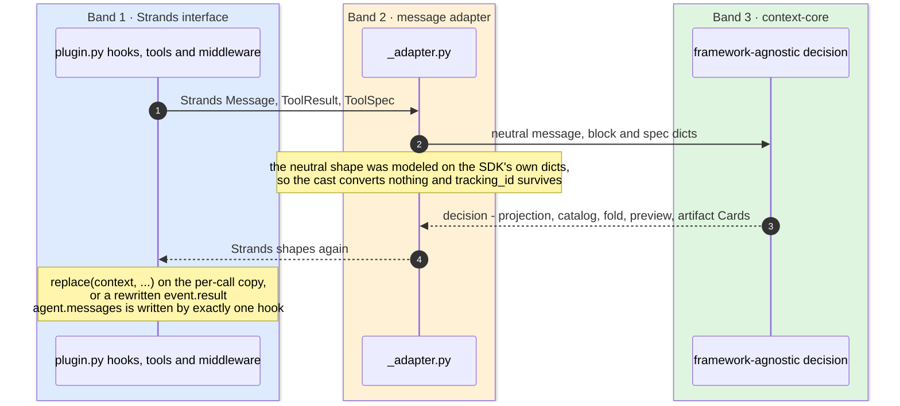
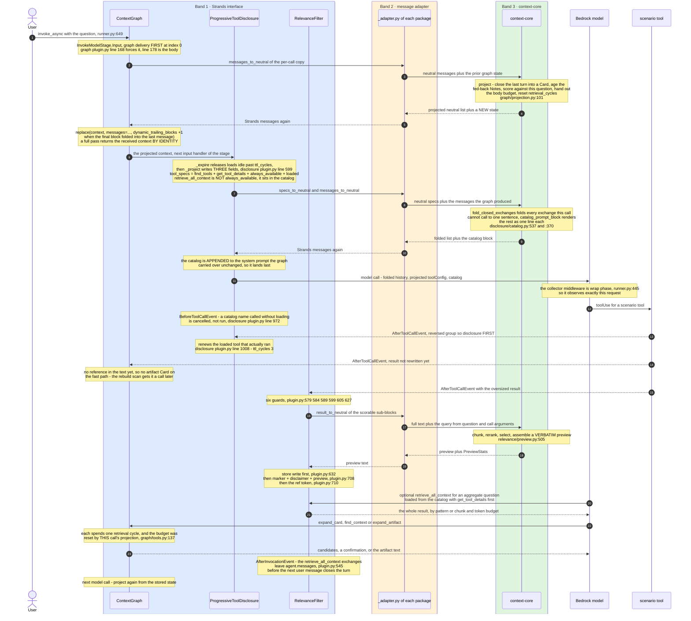

# Combined Stack — how the three Strands plugins are wired together

Scope: how the community-plugin validation harness (`validation/community-plugin-A-B-D`) assembles
`RelevanceFilter` (A), `ProgressiveToolDisclosure` (B) and `ContextGraph` (D) into one agent, and how
those three interact at runtime. Every claim carries a `file.py:LINE`. Sources of truth: `runner.py`
and `config.py` in that harness, the three packages' `plugin.py` registration sites for the ordering
contract, and `context-core` for every decision the three actually make.

All line references are into one of three trees, named per reference:

| Band | Tree | Files |
|------|------|-------|
| **1. Strands interface** | `strands-community-plugins/strands-{relevance-filter,context-graph,progressive-tool-disclosure}/src/strands_*/` | `plugin.py`, `_compat.py` |
| **2. Message adapter** | the same three packages | `_adapter.py` |
| **3. `context-core`** | `context-core/src/context_core/` | `message.py`, `relevance/{preview,store,search}.py`, `disclosure/{catalog,tool_index}.py`, `graph/{projection,cards,store,tools,scoring,matcher}.py` |

§§9–11 reference `validation/community-plugin-A-B-D/src/` (`runner.py`, `config.py`, `run.py`,
`metrics.py`).

> **Reading the references.** The three packages each ship a file named `plugin.py`, `_adapter.py` and
> `_compat.py`. A bare `plugin.py:LINE`, `_adapter.py:LINE` or `_compat.py:LINE` in this document
> resolves to the **relevance filter's**
> (`strands-community-plugins/strands-relevance-filter/src/strands_relevance_filter/`). References into
> the graph's and the disclosure plugin's band-1 and band-2 files are spelled out with their package
> word and a prose line number — "graph `plugin.py`, line 147" — never as `file.py:LINE`, so nothing
> here can be read against the wrong file. Core references always carry their subpackage
> (`graph/projection.py:101`), and harness references are bare names.
>
> **Each package is a thin binding.** The decision is `context-core`'s, the shape conversion is
> `_adapter.py`'s, and only band 1 knows what Strands is. The Strands modules that used to hold the
> decisions — the graph's `projection.py`, `store.py`, `cards.py`, `tools.py`, `state.py` and
> `matcher.py`, the filter's `preview.py`, `store.py`, `search.py` and `reranker.py`, the disclosure
> plugin's `index.py` and its catalog and fold helpers — are gone from the packages and live under
> `context_core/{relevance,disclosure,graph}/`. The folder itself was renamed
> `community-plugins/` → `strands-community-plugins/`.

---

## 1. The three bands, and what each one owns



What each band holds, per plugin:

| | Band 1 — Strands interface | Band 2 — message adapter | Band 3 — `context-core` |
|---|---|---|---|
| **A** `RelevanceFilter` | `_on_after_tool_call` (`plugin.py:568`), `_on_after_invocation` (`plugin.py:545`), the `retrieve_all_context` `@tool` (`plugin.py:388`), `init_agent` (`plugin.py:306`); the SDK symbols in `_compat.py` — `AfterToolCallEvent` (`_compat.py:14`), `_AgentAsTool` (`_compat.py:24`) | `messages_to_neutral` (`_adapter.py:28`), `messages_from_neutral` (`_adapter.py:33`), `result_to_neutral` (`_adapter.py:38`) | `build_with_stats` (`relevance/preview.py:505`), `excerpt_disclaimer` (`relevance/preview.py:547`), `read_chunks` (`relevance/preview.py:584`), `FileStore` (`relevance/store.py:226`), `_search_content` (`relevance/search.py:40`), `latest_user_text` (`message.py:80`) |
| **B** `ProgressiveToolDisclosure` | `_projection_handler` (disclosure `plugin.py`, line 749, registered at line 747 in `init_agent`, line 730), `_project` (line 599), `_compose_projection` (line 556), `_on_before_tool_call` (line 972), `_on_after_tool_call` (line 1008), the two `@tool` members `find_tools` (line 867) and `get_tool_details` (line 927); `InvokeModelStage` imported in its `_compat.py` at line 13 | `messages_to_neutral`, `messages_from_neutral` and `specs_to_neutral` (disclosure `_adapter.py`, lines 28, 33 and 38) | `fold_closed_exchanges` (`disclosure/catalog.py:537`), `catalog_prompt_block` (`disclosure/catalog.py:370`), `requires_parameters` (`disclosure/catalog.py:203`), `clamp_summary` (`disclosure/catalog.py:231`), `truncate_description` (`disclosure/catalog.py:128`), `LexicalToolIndex` (`disclosure/tool_index.py:177`) |
| **D** `ContextGraph` | `_Delivery` (graph `plugin.py`, line 113) with `register` (line 147) and `deliver` (line 178), `init_agent` (line 670), `_on_after_tool_call` (line 835), the three `@tool` members (lines 955, 983, 1026), `retrieval_tool_names` (line 727); `InvokeModelStage` and `NullConversationManager` in its `_compat.py` at lines 23–24, plus the host-symbol registration at lines 48–56 | `messages_to_neutral`, `messages_from_neutral` and `result_to_neutral` (graph `_adapter.py`, lines 33, 38 and 43) | `project` (`graph/projection.py:101`), `Thresholds` (`graph/projection.py:68`), `derive_and_register_artifacts` (`graph/cards.py:779`), `record_references` (`graph/store.py:191`), `resolve_artifact` (`graph/store.py:284`), and the three tool bodies: `expand_card` (`graph/tools.py:97`), `expand_artifact` (`graph/tools.py:195`), `find_context` (`graph/tools.py:336`) |

Three consequences of the split that the combined arm depends on:

1. **The adapters convert nothing, and that is a guarantee rather than a shortcut.** The neutral shape
   was modeled on the Strands message dict, so `messages_to_neutral` (`_adapter.py:28`) is a new list
   over the same dicts and `result_to_neutral` (`_adapter.py:38`) is one cast. What the adapter
   guarantees is that unknown blocks — `reasoningContent`, `image`, `document`, `cachePoint` — and
   message-level keys such as the graph's `tracking_id` pass through untouched, and that nothing is
   mutated in place (`_adapter.py:33`). So a message one plugin hands down is the message the next one
   reads, with no normalization step between them to disagree about.
2. **The two folds are one core function away from each other.** D's removal and B's fold are both
   decided in band 3 — `project` (`graph/projection.py:101`) and `fold_closed_exchanges`
   (`disclosure/catalog.py:537`) — over the same neutral list. Neither can leave a `toolUse` without
   its `toolResult`, because each checks its own output: D's delivery returns the received list by
   identity on a full pass (graph `plugin.py`, line 192) and B's fold re-sends the unfolded list when
   `pairs_intact` (`disclosure/catalog.py:628`) fails on what it produced.
3. **The one host symbol the stack registers is registered at the graph's band-1 boundary.**
   `context_core.graph.store` names no framework module of its own, so the optional bridges it reads
   come from `HOST_SYMBOLS` (`graph/store.py:97`), which the graph's `_compat.py` fills at import with
   the Strands locations of `extract_text`, `search_content` and the `ContextManager` Stash (lines
   48–53, under `setdefault` at lines 55–56, so a caller who registered first keeps the location).
   Unlike the LangGraph binding, all three entries are filled here: the Strands SDK has a
   `ContextManager` Stash, so `expand_artifact`'s second resolution layer is discovered rather than
   wired per instance.

---

## 2. A pipeline, not a competition

The three plugins act at two surfaces and on three different materials. They are **in series**, and
the earlier framing — that the filter and the graph "compete for the same job of deciding what of a
large payload survives" — was wrong:

- **`RelevanceFilter` acts on `AfterToolCallEvent`**, on a payload that has **not entered the history
  yet**: it decides what of that payload is worth writing down (`plugin.py:568`, the `@hook`-decorated
  `_on_after_tool_call`). It has one second engagement point, and it is a clean-up rather than a
  decision about a payload: `_on_after_invocation` (`plugin.py:545`) removes its own
  `retrieve_all_context` exchanges from `agent.messages` once the turn has ended (§7).
- **`ContextGraph` acts on `InvokeModelStage.Input`**, on the per-call copy of a history that
  **already exists**. It never sees a payload; it sees whatever was written down, and folds it to
  Titles / Descriptions / Full Content. Since the D-1 wiring it does this on **every model call** (§5).
- **`ProgressiveToolDisclosure` acts on the same stage**, and writes **three** fields of the call: it
  cuts `tool_specs` down to the tools that are callable on it, moves every other tool to a one-line
  catalog in `system_prompt`, and folds out of `messages` every tool exchange whose tool this call does
  not carry (`_project`, disclosure `plugin.py`, line 599).

So the filter makes the graph's input *smaller*, not *different in kind*. This is stated as the design
argument in `GraphTuning`'s own docstring (`config.py:428` onward).

**The consequence in code.** The harness used to select one of two graph tunings by asking whether the
filter was installed — the line read `tuning = GRAPH_WITH_RELEVANCE if config.relevance else
GRAPH_ALONE`, i.e. the graph inspecting whether some other plugin had trimmed its input first. Both
objects are gone. There is now one `GRAPH_TUNING` (`config.py:496`) used by every arm the graph appears
in, read at `runner.py:338` as the unconditional `tuning = GRAPH_TUNING`, with
`config.extra["_graph_tuning"] = "unified"` recorded beside it at `runner.py:339` so a run's provenance
says which regime produced it.

---

## 3. The wiring — how each of the five benchmark configurations is built

All plugin construction is in `build_plugins` (`runner.py:274`), which returns `[]` for the baseline
(`plugins: list[Any] = []` at `runner.py:290` with no appends taken). The five default configurations
are defined in `RUN_CONFIGS` (`config.py:604`) with the boolean flags `disclosure` / `relevance` /
`graph` on each `RunConfig` (`config.py:592`), and `build_plugins` reads those flags.

Construction order inside `build_plugins`, and what each plugin is attached with:

- **Relevance filter** — built under `if config.relevance:` (`runner.py:292`). Constructed at
  `runner.py:308` as `RelevanceFilter(...)` with `store=FileStore(str(storage_root))`
  (`runner.py:311`), **`include_retrieval_tool=RELEVANCE_RETRIEVAL_TOOL` (`runner.py:315`)**,
  `max_result_tokens=THRESHOLDS.max_result_tokens` (`runner.py:316`), and a `config={...}` dict
  carrying `reranker` (`runner.py:318`), `relevance_threshold`, `chunk_tokens`, `preview_tokens`.
  Appended at `runner.py:325`. `FileStore` is re-exported by the package but defined in the core
  (`relevance/store.py:226`). The store root is namespaced by run tag as well as configuration
  (`runner.py:297`), so two runs executing at once cannot serve each other's stored sub-blocks back
  through `retrieve_all_context` (comment at `runner.py:293`–`runner.py:296`). The reranker is
  `_MeteredDensityReranker` or `_MeteredReranker`, selected at `runner.py:300` by `DENSITY_RERANK`
  (`runner.py:192`); both subclass the package's **public** `BedrockReranker` (`runner.py:141`), which
  is itself the core class tagged `strands-agents` in the AWS user agent (`plugin.py:57`).
- **Context graph** — built under `if config.graph:` (`runner.py:330`), **after** the relevance filter
  and **before** disclosure. The ordering is load-bearing for one line: disclosure's
  `always_available` list reads `graph.retrieval_tool_names` (`runner.py:380`), so the graph has to be
  bound before the disclosure branch runs (comment at `runner.py:327`–`runner.py:328`). Constructed at
  `runner.py:341` as `ContextGraph(...)` taking every threshold off the one `tuning` —
  `expand_threshold` (`runner.py:342`) through `body_budget` (`runner.py:346`), `reuse_ttl_cycles`,
  `tags_per_card`, and `neighbors_per_candidate=tuning.neighbors_per_candidate` (`runner.py:351`) —
  plus `min_cards=THRESHOLDS.min_cards` (`runner.py:347`), `include_artifact_tool=True`
  (`runner.py:357`), and `matcher=matcher` (`runner.py:358`, the `_MeteredMatcher` built at
  `runner.py:331`). Appended at `runner.py:362`, with
  `config.extra["_graph_artifact_tool_dropped"] = False` recorded at `runner.py:360`.
- **Progressive tool disclosure** — built under `if config.disclosure:` (`runner.py:364`), appended and
  constructed at `runner.py:365`–`runner.py:366` as `ProgressiveToolDisclosure(...)` with
  `catalog_chars=THRESHOLDS.catalog_chars` (`runner.py:367`), `ttl_cycles` (`runner.py:368`, default
  `3` — `config.py:421`), `top_k` (`runner.py:369`) and the `always_available=[...]` list
  (`runner.py:379`, composition in §8). Those four arguments are the whole call: the constructor
  (disclosure `plugin.py`, line 673) carries no `referenced_source` parameter (§8) and no placement
  flag — the catalog always goes to the system prompt.

The five configurations, expressed as which of the above three branches fire:

| Config | disclosure | relevance | graph | Plugins attached (construction order) |
|---|---|---|---|---|
| `baseline` (`config.py:605`) | no | no | no | none (`runner.py:290`) |
| `relevance` (`config.py:616`) | no | yes | no | `RelevanceFilter` |
| `disclosure` (`config.py:626`) | yes | no | no | `ProgressiveToolDisclosure` |
| `graph` (`config.py:636`) | no | no | yes | `ContextGraph` |
| `all` (`config.py:646`) | yes | yes | yes | `RelevanceFilter`, `ContextGraph`, `ProgressiveToolDisclosure` |

Every arm the graph appears in uses the same `GRAPH_TUNING` (`runner.py:338`), so the tuning column the
earlier version of this table carried no longer exists.

(The harness also accepts three leave-one-out arms — `no-disclosure`, `no-relevance`, `no-graph`,
`config.py:657`, `config.py:671`, `config.py:683` — not run by default; `DEFAULT_CONFIGURATIONS` at
`config.py:696`, `CONFIGURATIONS` at `config.py:705`.)

**The baseline alone gets a session manager.** `_session_manager` (`runner.py:389`) returns a
`FileSessionManager` only for the arm with none of the three flags set, and `None` for every plugin
arm: the baseline stands for the agent as it ships, and an agent as it ships persists its messages.
It is attached conditionally in `build_agent` (`runner.py:416`, applied at `runner.py:438`). The
session id is fresh on every agent — configuration plus a random suffix under the run tag — because an
existing id is *restored*, which would start the agent on a history it did not build.
`VALIDATION_SESSION=off` removes it from the baseline too (`SESSION_MANAGER`, `config.py:582`). What
lands on disk is the live history, so the filter's cuts are in it and the graph's folds are not
(`config.py:577`–`config.py:579`).

**Conversation-manager requirement.** Every configuration builds its agent with
`conversation_manager=NullConversationManager()` (`runner.py:437`). This is a documented precondition of
the graph, not a preference: `ContextGraph` never mutates `agent.messages`; it only folds the per-call
copy handed to `InvokeModelStage`. Any non-null manager (a sliding window, a summarizer) edits the
**live** message list before the call is assembled, so it can physically drop a message the graph only
meant to fold — and raising that Card's Resolution back up then recovers nothing. The plugin enforces
this by warning: `_warn_on_destructive_manager` (graph `plugin.py`, defined at line 757, called from
`init_agent` at line 698) emits `_MANAGER_WARNING` (line 283) unless the manager is a
`NullConversationManager`, which the graph's `_compat.py` imports at line 24. The runner's module
docstring states the same at `runner.py:26`. It is also a comparison-hygiene reason: it keeps history
handling from being a confounding variable across configurations (comment at
`runner.py:435`–`runner.py:436`). The same precondition now covers disclosure too, for the same reason:
its fold also rewrites only the per-call copy.

The measurement middleware is registered **after** construction at `runner.py:445`
(`agent._middleware_registry.add_middleware(InvokeModelStage, collector.middleware())`). It is a
**wrap**-phase handler (`metrics.py:304`), and the SDK sorts input handlers ahead of wrap handlers, so
it observes the projection the plugins produced rather than the pre-plugin baseline.

---

## 4. Plugin order is a structural guarantee, not a wiring accident

Two facts, read together, fix the delivery order regardless of what the `plugins=[...]` list says.

**The graph forces itself to index 0.** `_Delivery.register` (graph `plugin.py`, defined at line 147)
calls the public `registry.add_middleware(InvokeModelStage.Input, self.deliver)` at line 165, then
moves its own handler to the front of the stage's list with `handlers.insert(0, handlers.pop())` at
line 168. That one line is the only private read in the registration and the only part allowed to
fail: on failure the delivery stays registered in wiring order and `register` returns `False` (line
172), which `init_agent` hands to `_warn_on_memory_fold_ordering` (line 703, warning itself at line
779, text `_ORDERING_WARNING` at line 263). What `_delivery_precedes_memory_fold` (line 344) can and
cannot claim is stated there: an unreadable registry, an empty list and a failed move all read the
same way, so the answer is `False` and the caller warns rather than reassures.

**The SDK builds the chain back to front.** `MiddlewareRegistry.compose`
(`strands/_middleware/registry.py`, line 117 in the pinned SDK) walks the sorted handlers with
`for i in range(len(sorted_handlers) - 1, -1, -1)` — line 129 — wrapping each one around the chain built
so far. The **last** handler becomes the innermost layer and the **first** becomes the outermost. So
index 0 runs *first*.

Therefore, in the `all` configuration:

1. **`ContextGraph`'s delivery runs first** (index 0): `deliver` (graph `plugin.py`, line 178) runs one
   `project` (`graph/projection.py:101`) and folds `messages` to Titles / Descriptions / Full Content.
2. **`ProgressiveToolDisclosure._projection_handler` runs next** (registered at line 747 of disclosure
   `plugin.py`, body at line 749) and writes `tool_specs`, `system_prompt` and `messages`.
3. **The catalog block is appended last.** The graph's delivery returns
   `replace(context, messages=messages_from_neutral(projected), ...)` (graph `plugin.py`, lines
   197–201), a `dataclasses.replace` that substitutes `messages` and `dynamic_trailing_blocks` and
   carries **every other field over unchanged** — `system_prompt` included. The disclosure handler then
   appends its block via `_append_to_system_prompt(context.system_prompt, block)` (disclosure
   `plugin.py`, helper at line 208, applied at line 638), rendering it with the core's
   `catalog_prompt_block` (`disclosure/catalog.py:370`, header at `disclosure/catalog.py:401`). Because
   disclosure runs after the graph and the graph preserved the prompt, the catalog lands on an
   untouched system prompt and lands last. This is not conditional: the catalog is the only placement,
   so the guarantee carries every projected call rather than one opt-in mode.

**The two delivery-side plugins both write `messages`, and they compose rather than contend — because
the order above is fixed.** The graph decides *which turns* enter the call and *at what Resolution*.
Disclosure then takes the list the graph produced and, inside the **closed** turns of it, folds every
tool exchange whose tool is absent from this call's `tool_specs`: the `toolUse` block is dropped and
its `toolResult` becomes one plain sentence from `fold_note` (`disclosure/catalog.py:452`, applied at
`disclosure/catalog.py:599`). Two different cuts on the same field, applied in a fixed order, and the
second one carries its own safety net — `pairs_intact` (`disclosure/catalog.py:518`): if the fold ever
breaks a `toolUse`/`toolResult` adjacency the received messages are sent instead and one warning is
logged (`disclosure/catalog.py:628`–`disclosure/catalog.py:629`). `agent.messages` is untouched by both.

`tool_specs` and `system_prompt` remain disclosure's alone (its `_projection_handler` docstring at
line 752 states it is "the only place either field is ever rewritten"). Index 0 is load-bearing for the
graph-vs-memory-manager rule (`_delivery_precedes_memory_fold`, graph `plugin.py`, line 344), and now
also for the order of the two folds.

---

## 5. The D-1 wiring: one `project` per model call

The graph used to spread its work across three hooks — a `MessageAddedEvent` write half, a
`BeforeInvocationEvent` that froze the Turn Choice, and an `InvokeModelStage.Input` delivery that
applied it. **Those two hooks are gone.** `init_agent` (graph `plugin.py`, line 670) now registers
exactly two engagement points: one `AfterToolCallEvent` hook (line 701) and the delivery (line 702).
The delivery calls `project` (`graph/projection.py:101`) on every model call, which runs the write
half, the read half and the delivery in one pass — the same wiring the LangGraph binding has.

Four things follow, and all four are per **model call** rather than per **user turn**:

- **The Turn Choice is recomputed on every call.** `project` closes the last turn into a Card
  (`close_turns`, `graph/projection.py:136`) and then recomputes `choose`
  (`graph/projection.py:142`). A Card that `expand_card` raised mid-turn therefore loses its rewritten
  choice at the next model call — but not the raise: `expand_card` also records a fed-back Note
  (`record_reuse`, `graph/scoring.py:97`), and that Note is what carries the request across the
  boundary into the next `choose`.
- **The reuse TTL clock ticks per call.** `project` ages the fed-back Notes against the state's own
  turn ordinal (`expire_reuse`, `graph/projection.py:141`, implementation at `graph/scoring.py:119`)
  and then increments it (`graph/projection.py:144`). The ordinal advances once per projection, so
  `reuse_ttl_cycles=5` (`runner.py:349`) buys five model calls, not five user turns.
- **The retrieval budget resets per call.** `project` sets `retrieval_cycles` back to zero
  (`graph/projection.py:146`), and each of the three tools spends one against it
  (`graph/tools.py:137`) before `_exhausted` (`graph/tools.py:70`) refuses with `_EXHAUSTED`
  (`graph/tools.py:58`). So `max_retrieval_cycles` now bounds the retrievals of one model call rather
  than of one turn.
- **The tools read the same ordinal.** All three pass `cycle=self._state_for(agent).turn` (graph
  `plugin.py`, lines 977, 1020 and 1048) rather than `agent.event_loop_metrics.cycle_count`, so the
  graph's clock is the one `project` advances and nothing else.

**`dynamic_trailing_blocks` is still set.** `project` returns no trailing-block count, so the delivery
reads it off the result: the open turn is never removed, so the last message of the projection is the
last message received, and it is a new object only when the final block was folded into it. That case
counts as one, and the count is *added* to the value the context arrived with — `folded_last` and the
`replace` at graph `plugin.py`, lines 196–200 — so a provider keeps the final block out of its cached
prefix.

**The one hook the graph kept is the artifact recorder.** `_on_after_tool_call` (graph `plugin.py`,
line 835) derives artifact Cards from the references a replaced tool result names
(`derive_and_register_artifacts`, `graph/cards.py:779`) and records those references in the agent's
own reference store (`record_references`, `graph/store.py:191`, store at `graph/store.py:135`). It
writes addresses only, never content.

Note that `B`'s cycle counter is **not** the graph's. The disclosure plugin reads
`agent.event_loop_metrics.cycle_count` for expiry and renewal (disclosure `plugin.py`, lines 772 and
961), which no projection touches, so the two clocks are independent and neither plugin can move the
other's TTL.

---

## 6. The hook-order table

Strands orders callbacks for one event by callback `order` (default `0`), then by registration order;
for `After*` events the SDK reverses within a group
(`strands/hooks/events.py`, `should_reverse_callbacks` at line 299 for `AfterToolCallEvent`). None of
the three plugins passes a non-default `order` at its registration site, so within each event the
tie-break is **registration order**. The plugin registry initializes each plugin and then registers its
discovered hooks, plugin by plugin in list order
(`strands/plugins/registry.py`, `add_and_init` at line 68), so that order follows the `plugins=[...]`
list — per §3: `RelevanceFilter`, then `ContextGraph`, then `ProgressiveToolDisclosure`.

Registration sites:

- `RelevanceFilter`: **two** `@hook`-decorated methods — `_on_after_tool_call` on `AfterToolCallEvent`
  (`plugin.py:568`) and `_on_after_invocation` on `AfterInvocationEvent` (`plugin.py:545`); both events
  imported through `_compat.py:14`. Plus one `@tool` member, `retrieve_all_context` (`plugin.py:388`,
  decorator at `plugin.py:387`), which is registered by default and **de-registered in `init_agent`**
  (`plugin.py:322`) only when the flag is off — see §7.
- `ContextGraph`: two engagement points in `init_agent` (graph `plugin.py`, line 670):
  `agent.add_hook(self._on_after_tool_call, AfterToolCallEvent)` (line 701) and
  `self._projection.register(agent)` (line 702), which inserts its delivery handler at index zero of
  `InvokeModelStage`. Its `_hooks` list is set empty before `super().__init__()` (line 667), so the
  per-agent handler count is verifiable by inspection rather than through discovery. Plus three `@tool`
  members — `expand_card` (line 955), `expand_artifact` (line 983), `find_context` (line 1026) — of
  which `expand_artifact` is dropped when `include_artifact_tool` is false
  (`_drop_artifact_tool_if_excluded`, line 705, called at line 699, guard at line 720).
- `ProgressiveToolDisclosure`: one `InvokeModelStage.Input` middleware handler (disclosure
  `plugin.py`, registered at line 747) plus **two** `@hook`-decorated methods —
  `_on_before_tool_call` on `BeforeToolCallEvent` (line 972) and `_on_after_tool_call` on
  `AfterToolCallEvent` (line 1008) — and two `@tool` members, `find_tools` (line 867) and
  `get_tool_details` (line 927).

Events with more than one subscriber in the `all` configuration:

| SDK event | Subscribers, in SDK call order | Load-bearing? | Why |
|---|---|---|---|
| `AfterToolCallEvent` | three: registration order is relevance, graph, disclosure, and `After*` is reversed within the group, so at call time it is `ProgressiveToolDisclosure._on_after_tool_call`, then `ContextGraph._on_after_tool_call`, then `RelevanceFilter._on_after_tool_call` | **No.** | Disclosure's hook only renews the TTL of a tool that actually ran, writing nothing but its own per-agent exposure map (disclosure `plugin.py`, line 1008), so its position in the group cannot matter. For the other two: the filter rewrites `event.result` into a marker, a disclaimer, a preview and a reference token, and the graph's hook reads references off that text to register artifact Cards. Running before the rewrite, the graph sees no reference on the fast path. The graph's own docstring settles it (graph `plugin.py`, line 843): the hook is "the fast path, not the only one", because the rebuild scan reads the same references off the same preview text later, which "makes this hook's registration order against the offloader's irrelevant, costing at most a turn of latency". A result naming no reference "registers nothing and logs nothing" (same docstring, line 846). |
| `InvokeModelStage.Input` (middleware, not a hook, but a shared stage) | `ContextGraph`'s delivery at index 0, then `ProgressiveToolDisclosure._projection_handler`, then — in the wrap phase, which the SDK sorts after input — the harness's measurement middleware (`runner.py:445`, `metrics.py:304`) | **Yes — and guaranteed, not incidental.** | Per §4: index 0 plus back-to-front composition means the graph projects `messages` first, disclosure re-folds the closed turns of that same list and projects `tool_specs` second, and the catalog block is appended last on a `system_prompt` the graph carried over unchanged. |

Events with a single subscriber: `BeforeToolCallEvent` → `ProgressiveToolDisclosure._on_before_tool_call`
(disclosure `plugin.py`, line 972) only; `AfterInvocationEvent` → `RelevanceFilter._on_after_invocation`
(`plugin.py:545`) only. `MessageAddedEvent` and `BeforeInvocationEvent` have **no** subscriber in any
configuration — the graph's two handlers on those events were removed with the D-1 wiring (§5).

---

## 7. The two retrieval tools, and what keeps them from being one job

**`RelevanceFilter.include_retrieval_tool` defaults to `True`** — the signature default at
`plugin.py:271`, documented in the class docstring at `plugin.py:242` and in `__init__`'s at
`plugin.py:282`. So in the default configuration the filter **does** store the raw sub-blocks and
**does** mint a reference token, and `retrieve_all_context` is registered alongside the graph's own
three tools. The harness passes the flag through from the environment:
`include_retrieval_tool=RELEVANCE_RETRIEVAL_TOOL` (`runner.py:315`), where
`RELEVANCE_RETRIEVAL_TOOL = os.environ.get("VALIDATION_RELEVANCE_RETRIEVAL_TOOL", "1") != "0"`
(`runner.py:200`).

Three things make that safe, and none of them is "only one tool exists".

**1. The tool was narrowed and renamed.** `retrieve_context` is gone; `retrieve_all_context`
(`plugin.py:388`) loads the **whole** of one filtered result, for the one question an excerpt cannot
answer — a maximum, a total, a count, a ranking across every row. Its docstring says so in the
imperative, and the filter's own disclaimer says the same where the model reads the excerpt:
`excerpt_disclaimer` (`relevance/preview.py:547`) states that an aggregate cannot be computed from the
excerpt, then names the call, the reference, and the budgets that reach the rest of the result — a
`pattern` for the rows to aggregate, or `max_chunks`/`max_tokens` large enough for all of it. With no
reference to hand out it says only that the result was filtered. That disclaimer sits between the
`[Relevance: tool result, ~N tokens]` marker and the preview: the rewritten result is marker,
disclaimer, preview (`plugin.py:708`), then the `[ref: …]` / `[refs: …]` suffix when there is one
(`plugin.py:710`–`plugin.py:711`), and `event.result` is replaced with a new `ToolResult`
(`plugin.py:725`) rather than mutated. `max_chunks` and `max_tokens` are parameters of the tool itself
(`plugin.py:395`–`plugin.py:396`), which is what lets one call ask for the whole result instead of
paging; a `max_chunks` read hands back chunks in relevance order without scoring the text again,
because the ranking is kept per reference (`plugin.py:705`) and replayed by the core's `read_chunks`
(`relevance/preview.py:584`).

**2. A retrieval does not ride along.** `_on_after_invocation` (`plugin.py:545`) removes this plugin's
own `retrieve_all_context` exchanges from `agent.messages` as the invocation ends —
`_drop_tool_exchanges` (`plugin.py:117`) drops the `toolUse` and its `toolResult` as a pair, whole
messages when a message holds nothing else, dropping `reasoningContent` from any assistant message it
rewrites. The removal happens **before the next user message closes the turn**, so a context graph
deriving that turn's Card never sees the retrieved content. The hook is a no-op when the tool is off
(`plugin.py:558`). The harness names the cost this removes at `runner.py:312`–`runner.py:314`: every
retrieval re-sent on every later call, which once made this arm dearer than no plugin on Haiku 4.5
(+21.6%).

**3. It is deliberately kept out of `always_available`.** In the disclosure arm the tool is a catalog
name like any other, reached through `get_tool_details`, so its schema is off every call until an
aggregate question comes up (`runner.py:370`–`runner.py:374`). The graph's own
`retrieval_tool_names` property states the same exclusion from the other side (graph `plugin.py`,
line 727, and the exclusion in prose at lines 743–744).

**So the graph keeps its `expand_artifact`.** The old `include_artifact_tool=not config.relevance` drop
was removed once the collision it guarded against stopped existing — it is now
`include_artifact_tool=True` (`runner.py:357`), recorded as not dropped at `runner.py:360`. That drop
was measured, not assumed, and `_GRAPH_ARTIFACT_TOOL` (`runner.py:245`) is kept as the record of it: on
the first 60-turn run the `all` configuration was the only one that could not answer A5, and the model
said why — it had called `expand_artifact` with a reference the relevance filter had minted, over a
store `expand_artifact` cannot read. What changed is not the store topology but the presentation: the
filter's tool now names a different job in its own description and in the disclaimer that points at it,
and it is loaded from the catalog rather than sitting in `tool_specs` beside `expand_artifact`. Whether
the model still confuses the two is measured by the `all` arm, not assumed (`runner.py:245` docstring).
The graph's `expand_card` and `find_context` were never part of this: they reach back into the
conversation's own turns, a different job again.

**The references the two mint are disjoint, which is why the Stash bridge exists.** The filter's
reference is minted by its store — `mem_{counter}_{key}` for an `InMemoryStore`
(`relevance/store.py:156`) and a path under the artifact directory for the harness's `FileStore`
(`relevance/store.py:226`) — while the graph records whatever address the placeholder text already
carried. So a reference the filter minted misses the graph's own store and falls through to the second
layer, which `resolve_artifact` (`graph/store.py:284`) consults only for what the own store does not
hold. On Strands that second layer is discovered rather than wired: the `ContextManager` Stash is one
of the three `HOST_SYMBOLS` the graph's `_compat.py` registers (line 51), so the graph takes no `stash=`
parameter here and the harness passes none.

**`VALIDATION_RELEVANCE_RETRIEVAL_TOOL=0` measures the excerpt alone.** Filtering itself — chunk,
rerank, preview, rewrite in `_filter_and_rewrite` (`plugin.py:671`) — runs unchanged, because storage is
optional. Three things then do not happen:

1. **Nothing is stored.** `_store_raw` (`plugin.py:632`) returns early when the tool is off (guard at
   `plugin.py:646`), so the `FileStore` directory stays empty.
2. **No reference token is minted.** `references` stays empty (`plugin.py:650`), so the `[ref: …]`
   suffix (`plugin.py:710`) is never appended and the disclaimer takes its nothing-to-retrieve branch.
3. **No `retrieve_all_context` tool is registered.** `init_agent` drops the auto-discovered tool,
   matched by `tool_name` rather than by a literal (`plugin.py:324`) — which is why the plugin
   suppresses the other two: "a reference would be a promise nothing can keep"
   (`plugin.py:283`–`plugin.py:284`).

In that mode the `AfterToolCallEvent` ordering discussion in §6 is moot, since no reference token is
emitted at all for the graph's hook to read.

---

## 8. Sequence diagram — one full turn, all three plugins, default configuration

Default configuration means `include_retrieval_tool=True`: one tool result filtered to a marker, a
disclaimer and a preview **with** a reference token, the graph projecting history on every model call,
the disclosure plugin projecting `toolConfig`, folding the closed turns' tool exchanges and appending
its catalog to the system prompt — and `retrieve_all_context` reachable only from that catalog.



Annotated arrows and handlers:

- the turn itself → `invoke_async` (`runner.py:649`), one await per scripted turn against one agent;
  the turn's tool names are recovered afterwards by `_tool_calls_in_last_turn` (`runner.py:711`), and a
  turn cut short at `max_tokens` has its partial answer read back out of history by `_partial_answer`
  (`runner.py:591`) rather than scored as silence.
- history projection on the call → the graph's `deliver` (graph `plugin.py`, line 178), registered at
  index 0 by `self._projection.register(agent)` (line 702); it converts with its `_adapter.py`, calls
  `_project_state` (line 887) into the core's `project` (`graph/projection.py:101`) with the
  instance's `Thresholds` (`graph/projection.py:68`, built at graph `plugin.py`, line 910), and writes
  the new state back into the weakly keyed per-agent map.
- the three-field projection → `_projection_handler` (disclosure `plugin.py`, line 749). It expires
  stale loads (`_expire`, line 404, called at line 772), builds the index and any missing catalog
  summaries on a changed fingerprint (`_ensure_index`, line 789), calls `_project` (line 599), and
  records the names the projection carried in `state.projected` (line 782) for the guard below. Any
  failure on this path degrades to the context received — today's behaviour without the plugin.
- oversized tool result intercepted → `_on_after_tool_call` (`plugin.py:568`) → `_filter_and_rewrite`
  (`plugin.py:671`): the store write (`_store_raw`, `plugin.py:632`), the query from the newest user
  question plus this call's arguments (`_build_query`, `plugin.py:353`, which reads
  `latest_user_text` at `message.py:80`), the core's `build_with_stats`
  (`relevance/preview.py:505`), the disclaimer (`excerpt_disclaimer`, `relevance/preview.py:547`), the
  marker (`plugin.py:708`), the reference suffix (`plugin.py:710`), and a new `ToolResult`
  (`plugin.py:725`). The preview builder itself is created on the first filtered result
  (`_resolve_preview`, `plugin.py:327`), so a filter that never fires needs no AWS credentials merely
  to be declared.
- the size gate → the result is wrapped as a message and the agent's **own** model counts it
  (`count_tokens`, `plugin.py:598`), compared against `_max_result_tokens` (`plugin.py:599`). That is
  the one guard the LangGraph binding has to approximate and this one does not.
- graph sees the unrewritten result → `_on_after_tool_call` (graph `plugin.py`, line 835): it runs
  before the filter rewrites, so there is no reference in the text for it yet and the rebuild scan
  picks it up a call later (docstring, line 843).
- turn ends → `_on_after_invocation` (`plugin.py:545`): the retrieval exchanges leave `agent.messages`
  via `_drop_tool_exchanges` (`plugin.py:117`).

**What `tool_specs` carries, and for how long.** The projection is the union of three blocks, in a fixed
order and each name at most once — the two plugin tools, `always_available`, and the tools currently
loaded (`_compose_projection`, disclosure `plugin.py`, line 556). **The tools the history merely
mentions are not among them.** Bedrock Converse accepts a history `toolUse` whose tool is absent from
`toolConfig` — probed on Claude Haiku 4.5, Claude Opus 4.8, GLM 4.7 Flash and Qwen3 Next (module
docstring, lines 14–16) — so retaining them bought nothing and made `tool_specs` grow with every tool
the conversation had ever touched (line 570). The `referenced` block, its two helpers and the
`referenced_source` constructor parameter are gone, and with them the harness's
`_graph_referenced_source` bridge; the runner's module docstring records the removal at
`runner.py:20`–`runner.py:24`.

A load lives `ttl_cycles` cycles without use — `_DEFAULT_TTL_CYCLES = 3` in the plugin (line 93), and
`3` from the harness too (`config.py:421`). `get_tool_details` loads (line 927, `_renew` at line 427
called from line 961), `_on_after_tool_call` renews on every call that **actually ran** — a cancelled
call renews nothing (line 1008) — and `_expire` drops anything idle for more than `ttl_cycles`
(line 404). The `BeforeToolCall` hook renews nothing at all.

**How the model is told to use the catalog.** `CATALOG_PROMPT_HEADER` (`disclosure/catalog.py:84`,
rendered by `catalog_prompt_block` at `disclosure/catalog.py:370`) states the rule where the names are
read: the listed tools are NOT in the tool list and MUST NOT be called directly, a direct call is
rejected without running, and then three numbered steps — call `get_tool_details` with the names as a
list, call them on the next call, and repeat step 1 if a call is rejected because the tool was
unloaded. `find_tools` is named as the fallback for a need no listed name fits. The loading tool's own
result header repeats the expiry (`_DETAILS_LOADED_HEADER`, disclosure `plugin.py`, line 104).

**The premature-call guard** (`_on_before_tool_call`, disclosure `plugin.py`, line 972) sits on the
`toolUse` edge. It skips a name the registry does not have, the two plugin tools and anything in
`always_available`; it allows a name in `state.projected`, the names the **last** projection actually
carried (read at line 997), so a tool that expired between the projection and the call is never
mistaken for a guess. Otherwise, if the tool has a required parameter (`requires_parameters`,
`disclosure/catalog.py:203`) the call is cancelled with `_PREMATURE_CALL_MESSAGE` (line 132, applied at
line 1004), which points the model at `get_tool_details`. It does **not** load the tool on the model's
behalf: the old "they are available now — call it again" recovery taught the model that calling a
catalog name directly works, which is the one shortcut the catalog rule forbids.

`always_available` is what keeps a retrieval tool off that edge — `runner.py:379`–`runner.py:382`:

```python
always_available=[
    *(graph.retrieval_tool_names if graph is not None else ()),   # runner.py:380
    "list_accounts",                                               # runner.py:381
]
```

Two things about this composition. `"retrieve_context"` **was removed** and its successor
`retrieve_all_context` was **not** put back: it is for the rare question that needs a whole result, so
it stays in the catalog and costs a load only then (`runner.py:370`–`runner.py:374`, and the graph's own
`retrieval_tool_names` docstring at graph `plugin.py`, lines 743–744). And what remains is derived, not
literal — the graph's `retrieval_tool_names` (graph `plugin.py`, property at line 727, returning the
tool names still registered on the instance, so a de-registered `expand_artifact` is already absent)
plus **one literal, `list_accounts`** — which is a **domain tool of the scenario, not a plugin's**
(comment at `runner.py:376`–`runner.py:378`). The graph's three must be always-available because a tool
that is only in the catalog is not in `tool_specs` at all and has to be loaded with `get_tool_details`
before it can be called, so a retrieval tool left to discovery would cost a cycle learning what the
folded-context guidance already told the model to do (`runner.py:370`–`runner.py:372`; the same
argument from the plugin's side at graph `plugin.py`, lines 730–735).

**Why the fold is shaped the way it is.** `fold_closed_exchanges` (`disclosure/catalog.py:537`) folds
**only closed turns**: `_current_turn_start` (`disclosure/catalog.py:473`, called at
`disclosure/catalog.py:569`) is the last user message carrying no `toolResult`, and the first message
plus everything from that boundary on — the turn in flight, tool loop included — pass through as the
very same objects. Three provider constraints dictate the rest. A `toolUse` with real arguments sitting
next to a success is a template the model repeats once the tool has left `tool_specs`, so the `toolUse`
goes and the `toolResult` becomes `fold_note`'s sentence — `The tool X was called and the result was:
Y`, or `... failed with: Y` on an error (`disclosure/catalog.py:452`) — with image and document parts
kept. Reasoning models reject a modified latest assistant message, which is why the turn in flight is
untouched and why a rewritten or merged assistant message loses its `reasoningContent`
(`_without_reasoning`, `disclosure/catalog.py:494`). And Converse rejects text placed before the
`toolResult` answering the previous assistant message, so user messages put their `toolResult` blocks
first (`_results_first`, `disclosure/catalog.py:502` — both applied by `_tidy` at
`disclosure/catalog.py:512`). The plugin's own `find_tools` / `get_tool_details` exchanges are dropped
outright, with no sentence, because `drop_names` defaults to `PLUGIN_TOOL_NAMES`
(`disclosure/catalog.py:67`). Emptied messages are dropped and same-role neighbours merged
(`disclosure/catalog.py:615`); if the folded span ends with a user message it is joined into the
opening user message of the turn in flight (`disclosure/catalog.py:624`).

---

## 9. The graph's one tuning

`GRAPH_TUNING` (`config.py:496`) is the whole of the graph's configuration, for every arm it appears in.
Values as constructed, each one env-overridable:

| Knob | Value | Reader |
|---|---:|---|
| `expand_threshold` | `0.62` | `config.py:497` |
| `collapse_floor` | `0.45` | `config.py:498` |
| `link_threshold` | `0.50` | `config.py:499` |
| `description_tokens` | `BUDGETS.graph_description_tokens` — `100` large / `250` tight | `config.py:500` |
| `body_budget` | `40_000` | `config.py:501` |
| `max_retrieval_cycles` | `BUDGETS.graph_max_retrieval_cycles` — `8` large / `4` tight | `config.py:502` |
| `reuse_ttl_cycles` | `5` | `config.py:503` |
| `tags_per_card` | `5` | `config.py:504` |
| `neighbors_per_candidate` | `0` | `config.py:505` |

Two of these are counted in **model calls** rather than turns, which is the D-1 consequence of §5:
`reuse_ttl_cycles` ages against the ordinal `project` increments (`graph/projection.py:144`), and
`max_retrieval_cycles` bounds a budget `project` resets on every call (`graph/projection.py:146`).

Three of them are new or newly non-literal and cross the stack:

- **`body_budget` is `40_000`, not `None`.** The dataclass field is `int | None` (`config.py:473`) and
  the combined arm used to run it unbounded on the grounds that its peak call sat below any worthwhile
  ceiling. That premise is dead — the same arm on Opus 4.8 now peaks at 75,000–81,000, and the growth is
  message mass (25,598 → 38,507 tokens of messages against a flat 7,963 of tool schema). `None` is not
  "no ceiling" but *the step-down turned off*: the core moves a Card down a rung only when the
  remaining budget cannot fit it, so with `None` every Card at or above `expand_threshold` travels at
  full content however many there are. A Card that does not fit steps down **one** rung, to Description,
  never to Title. Full argument at `config.py:529`–`config.py:543`;
  `VALIDATION_GRAPH_BODY_BUDGET=none` restores the measured configuration.
- **`neighbors_per_candidate` is `0`, and the knob is the news rather than the value.** The plugin's own
  default is `3` (graph `plugin.py`, line 224). The `similar` edge has no reader at `0` — it is measured
  on the write path, stored with its similarity as the weight, propagates no Note, and is traversed by
  no retrieval path. Read, it answers what candidate ranking cannot: ranking scores each Description
  against the **question**, never against another Description, so two turns covering the same ground in
  different words are invisible to each other (`config.py:483`–`config.py:493`). It stays at `0`
  because every published figure was produced with the edge unread and a run above zero is not
  comparable on tokens; `VALIDATION_GRAPH_NEIGHBORS=3` turns it on for a sweep.
- **`description_tokens` is no longer a literal.** It comes from the window regime (§11). The `250` that
  was measured for the graph-alone arm was measured on a 200K-window model, i.e. the tight regime, where
  the unified set still gives `250`; on a large-window model that arm now gets `100`.
  `VALIDATION_GRAPH_DESCRIPTION_TOKENS=250` restores it.

What the unification costs in confidence, stated by the `GraphTuning` docstring (`config.py:428`, the
"Unmeasured as a unified set" paragraph at line 452): the set is **unmeasured as a unified set** —
these are the graph's own measured optimum, measured with no filter beside it. The measurement that
justified the old split is itself confounded: applying the graph-alone values with the filter present
lost five materially correct turns, but that run had `preview_tokens` at 800 against payloads ten to
thirty times that, so the Cards were starved by the **first** cut in the chain
(`config.py:446`–`config.py:450`). The preview is 2,000 in the tight regime now, so the condition that
produced the result no longer holds.

---

## 10. The env-var override surface

Every `VALIDATION_*` variable `config.py` reads (via `_env` (`config.py:60`) / `_env_int` / `_env_float`
/ `_env_bool` (`config.py:79`) / `_env_opt_int` (`config.py:96`); the `none`/`off` column applies to
`_env_opt_int`, which accepts `none/null/off/unbounded`):

| Variable | Plugin knob it overrides | Default | Accepts `none`/`off`? | Reader |
|---|---|---|---|---|
| `VALIDATION_ACCOUNT_ID` | account guard (not a plugin knob) | `""` | no | `config.py:111` |
| `VALIDATION_AWS_PROFILE` | AWS profile (not a plugin knob) | `None` | no | `config.py:123` |
| `VALIDATION_AGENT_MODEL_ID` | agent model id (not a plugin knob) | `"us.anthropic.claude-opus-4-8"` | no | `config.py:133` |
| `VALIDATION_MAX_OUTPUT_TOKENS` | model `max_tokens` (not a plugin knob) | `4_096` | no | `config.py:156` |
| `VALIDATION_WINDOW_REGIME` | regime selector (drives §11 budgets) | derived (`tight`/`large`) | no | `config.py:341` |
| `VALIDATION_MAX_RESULT_TOKENS` | RelevanceFilter `max_result_tokens` | `4_000` | no | `config.py:416` |
| `VALIDATION_PREVIEW_TOKENS` | RelevanceFilter `preview_tokens` | `BUDGETS.preview_tokens` (`800`/`2_000`) | no | `config.py:417` |
| `VALIDATION_CHUNK_TOKENS` | RelevanceFilter `chunk_tokens` | `500` | no | `config.py:418` |
| `VALIDATION_RELEVANCE_THRESHOLD` | RelevanceFilter `relevance_threshold` | `0.02` | no | `config.py:419` |
| `VALIDATION_CATALOG_CHARS` | ProgressiveToolDisclosure `catalog_chars` | `80` | no | `config.py:420` |
| **`VALIDATION_TTL_CYCLES`** | ProgressiveToolDisclosure `ttl_cycles` | `3` | no | `config.py:421` |
| `VALIDATION_TOP_K` | ProgressiveToolDisclosure `top_k` | `4` | no | `config.py:422` |
| `VALIDATION_MIN_CARDS` | ContextGraph `min_cards` | `3` | no | `config.py:423` |
| `VALIDATION_GRAPH_EXPAND` | ContextGraph `expand_threshold` | `0.62` | no | `config.py:497` |
| `VALIDATION_GRAPH_COLLAPSE` | ContextGraph `collapse_floor` | `0.45` | no | `config.py:498` |
| `VALIDATION_GRAPH_LINK` | ContextGraph `link_threshold` | `0.50` | no | `config.py:499` |
| `VALIDATION_GRAPH_DESCRIPTION_TOKENS` | ContextGraph `description_tokens` | `BUDGETS.graph_description_tokens` (`100`/`250`) | no | `config.py:500` |
| **`VALIDATION_GRAPH_BODY_BUDGET`** | ContextGraph `body_budget` | `40_000` | **yes** | `config.py:501` |
| `VALIDATION_GRAPH_MAX_RETRIEVAL_CYCLES` | ContextGraph `max_retrieval_cycles` | `BUDGETS.graph_max_retrieval_cycles` (`8`/`4`) | **yes** | `config.py:502` |
| `VALIDATION_GRAPH_REUSE_TTL` | ContextGraph `reuse_ttl_cycles` | `5` | no | `config.py:503` |
| `VALIDATION_GRAPH_TAGS` | ContextGraph `tags_per_card` | `5` | no | `config.py:504` |
| **`VALIDATION_GRAPH_NEIGHBORS`** | ContextGraph `neighbors_per_candidate` | `0` | no | `config.py:505` |
| `VALIDATION_SESSION` | baseline `FileSessionManager` (not a plugin knob) | `file` | no | `config.py:582` |
| `VALIDATION_CACHE` | agent prompt-cache TTL (not a plugin knob) | `None` | no | `config.py:938` |

Two experiment switches are read in `runner.py`, not `config.py`:

| Variable | Plugin knob it overrides | Default | Reader |
|---|---|---|---|
| **`VALIDATION_RELEVANCE_RETRIEVAL_TOOL`** | RelevanceFilter `include_retrieval_tool` — and with it the store write and the reference token (§7) | **on**; `=0` turns it off | `runner.py:200`, applied at `runner.py:315` |
| `VALIDATION_DENSITY_RERANK` | selects the density-prior reranker subclass | off | `runner.py:192`, applied at `runner.py:300` |

`_env_bool` (`config.py:79`) **raises** on a value that is neither truthy nor falsy rather than falling
back to the default, so a typo in a sweep variable cannot silently measure the default configuration
under the variant's name (`config.py:85`–`config.py:93`). `SESSION_MANAGER` raises on the same grounds
for a value other than `file`/`off` (`config.py:585`–`config.py:586`). The standard `AWS_REGION` /
`AWS_DEFAULT_REGION` are read at `config.py:120` and `AWS_PROFILE` at `config.py:123`, but none of them
is a `VALIDATION_*` variable. Every override a process actually read is recorded for the run through
`sweep_overrides()` (`config.py:106`).

Unlike the old two-tuning arrangement, **every graph knob is now reachable from the environment in every
arm the graph appears in** — there is no longer a literals-only tuning that a sweep cannot touch.

---

## 11. The window-regime split

`config.py` derives a `LARGE_WINDOW` / `TIGHT_WINDOW` regime from the agent model's context window.

- **Cut-off value.** `TIGHT_WINDOW_CEILING = 300_000` (`config.py:220`). A model whose context window is
  at or below this many tokens is in the tight regime.
- **The derivation.** `CONTEXT_WINDOWS` (`config.py:241`) maps model id → window; `WINDOW_REGIME`
  (`config.py:341`) is `tight` when `CONTEXT_WINDOWS.get(AGENT_MODEL_ID)` (defaulting to
  `TIGHT_WINDOW_CEILING + 1` when the model is absent, `config.py:343`) is `<= TIGHT_WINDOW_CEILING`,
  else `large`. `BUDGETS` (`config.py:354`) is then `TIGHT_WINDOW if WINDOW_REGIME == "tight" else
  LARGE_WINDOW`.
- **The three knobs that differ between regimes** (the `BudgetRegime` fields, `config.py:277`):

  | Knob | `LARGE_WINDOW` (`config.py:296`) | `TIGHT_WINDOW` (`config.py:319`) |
  |---|---|---|
  | `preview_tokens` (→ RelevanceFilter `preview_tokens`) | `800` (`config.py:297`) | `2_000` (`config.py:320`) |
  | `graph_description_tokens` (→ ContextGraph `description_tokens`) | `100` (`config.py:298`) | `250` (`config.py:321`) |
  | `graph_max_retrieval_cycles` (→ ContextGraph `max_retrieval_cycles`) | `8` (`config.py:299`) | `4` (`config.py:322`) |

  They reach the plugins through `THRESHOLDS.preview_tokens` (`config.py:417`) and the `GRAPH_TUNING`
  readers (`config.py:500`, `config.py:502`). Two of the three are now graph knobs of **every** arm, not
  just of a with-relevance tuning — that is the second change the unification made.
- **Why they are held as one set.** All three were reverted together in the Opus 4.8 comparison, so the
  aggregate is attributable and the individual contributions are not (`BudgetRegime` docstring,
  `config.py:280`–`config.py:283`). The two budgets are also in series — payload → preview budget → the
  message → the Card's numeric lines → Description budget (`config.py:335`) — so raising the second
  while the first starves buys nothing.
- **Where the regime is recorded in the run JSON.** `run.py:295` writes
  `"window_regime": config.WINDOW_REGIME` into the run metadata, alongside
  `"sweep_overrides": config.sweep_overrides()` at `run.py:292` and `"context_window"` at `run.py:296`.
- **The override variable.** `VALIDATION_WINDOW_REGIME` (`config.py:341`) — an explicit `tight` or
  `large` overrides the derived value; an empty/unset value falls through to the derivation.
