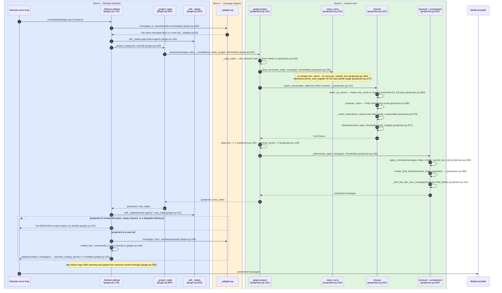
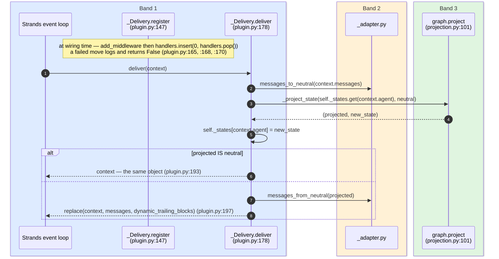
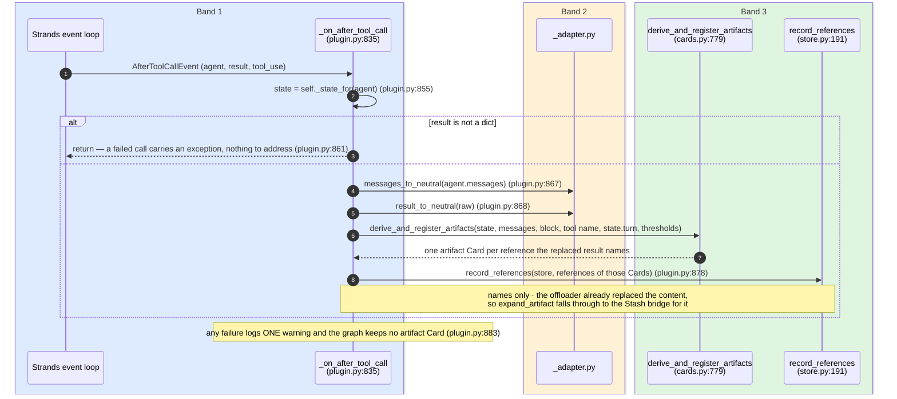
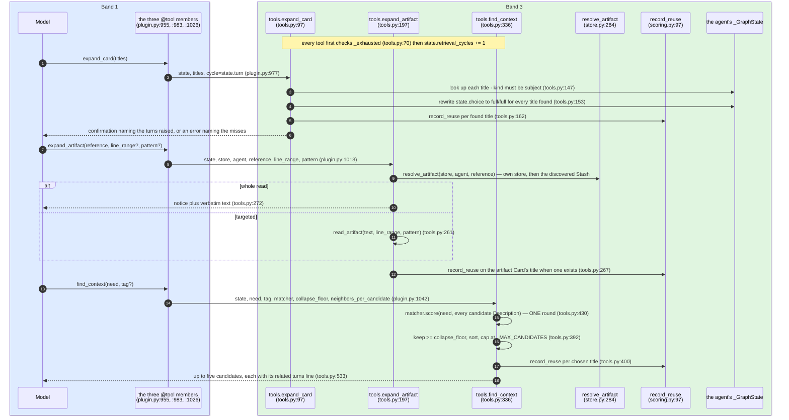
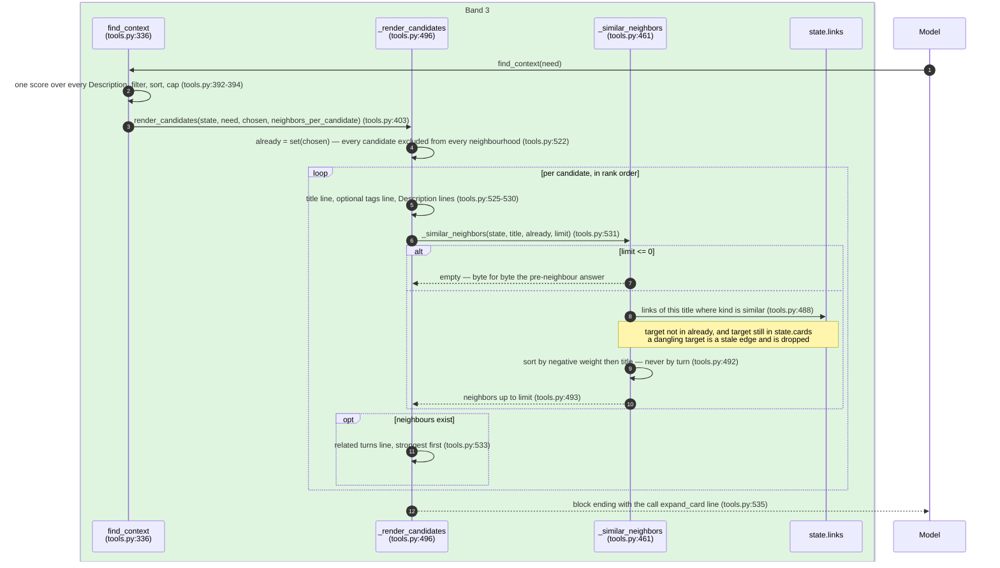

# Sequence Design — Practice D on Strands: `strands-context-graph`

All line references are into one of three trees, named per reference:

| Band | Tree | Files |
|------|------|-------|
| **1. Strands interface** | `strands-community-plugins/strands-context-graph/src/strands_context_graph/` | `plugin.py`, `_compat.py` |
| **2. Message adapter** | the same package | `_adapter.py` |
| **3. `context-core`** | `context-core/src/context_core/` | `message.py`, `graph/projection.py`, `graph/cards.py`, `graph/scoring.py`, `graph/removal.py`, `graph/compaction.py`, `graph/describe.py`, `graph/tools.py`, `graph/store.py`, `graph/state.py`, `graph/matcher.py` |

§11 references `validation/community-plugin-A-B-D/src/` (`runner.py`, `config.py`). Bare file names in band 3
resolve inside `graph/`; `message.py` is one level above it.

Companion document: `docs/design/sequence/langgraph/sequence-d-context-graph.md`, the LangGraph binding of the same
practice. The Card model, the scoring ladder, the removal and the compaction are shared code and are described here
only where the Strands binding changes what reaches the model.

> **The three-band split is the point of this binding.** No module under `context_core` may import a framework
> (`message.py:3`), and the binding never leaks a Strands type into the core: `_adapter.py` is "the only module of the
> package that touches both" (`_adapter.py:12`). Every *decision about content* — what closes a turn, what a Card
> holds, which rung it travels at, what the folded block says — is the same code the LangGraph and Hermes bindings run.
> What is Strands-specific is the attachment: one middleware stage, one event hook, three `@tool` members, and the
> `dynamic_trailing_blocks` count a Strands provider reads.
>
> **The package is four files.** `plugin.py` (1,052 lines) holds the construct, its validation and the two engagement
> points; `_compat.py` holds every Strands symbol, private ones included; `_adapter.py` is 45 lines of casts;
> `__init__.py` exports. The modules that used to sit beside them — `cards.py`, `scoring.py`, `projection.py`,
> `tools.py`, `store.py`, `compaction.py`, `describe.py`, `removal.py`, `state.py`, `matcher.py` — are now
> `context_core.graph` and are shared. `tests/test_binding.py` asserts both halves of that: `src/` holds only the
> binding's files, and only `_compat` imports `strands`.
>
> **DECISION D-1: one `project()` per model call.** The `InvokeModelStage.Input` handler runs the whole projection —
> write half, Turn Choice, delivery — on every model call (`_Delivery`, `plugin.py:113`), which is what the LangGraph
> binding does from `wrap_model_call`. The `BeforeInvocationEvent` and `MessageAddedEvent` hooks the plugin used to
> carry are **gone**. §7 is the consequence: the Turn Choice, the reuse TTL clock and `retrieval_cycles` advance per
> model call, not per user turn.

---

## 1. What the binding does, mechanically

`ContextGraph` (`plugin.py:506`) is a Strands `Plugin` that projects an agent's short-term memory as a graph of
**Cards** — one Card per *closed* turn, holding **addresses** (durable `tracking_id`s and a reference key) and derived
text, never message content (`Card`, `state.py:76`). It never mutates `agent.messages`: it reads the per-call copy the
event loop hands to `InvokeModelStage` and returns a new context.

Two engagement points, both registered in `init_agent` (`plugin.py:670`):

| Surface | Registered at | Strands symbol | What it does |
|---|---|---|---|
| **Delivery** | `plugin.py:702` (`self._projection.register(agent)`) | `InvokeModelStage.Input` middleware (`plugin.py:165`) | One `context_core.graph.project` per model call: write half, choice, removal and fold |
| **Artifact** | `plugin.py:701` (`agent.add_hook(self._on_after_tool_call, AfterToolCallEvent)`) | `AfterToolCallEvent` | Derives artifact Cards off a replaced tool result and notes their references |

Nothing else is registered. `init_agent`'s docstring states it as "exactly one handler of each type, per agent"
(`plugin.py:673`), and `self._hooks` is set to the empty list before `super().__init__()` runs so the per-agent handler
count is verifiable by inspection (`plugin.py:667`). `tests/test_plugin_init_agent.py` asserts exactly one input
middleware handler, no other hook type gaining a handler, and the system prompt, the history and the rest of the tool
registry coming out as they went in.

**Three retrieval tools**, auto-discovered by the plugin registry as the only `@tool` members of the class:
`expand_card` (`plugin.py:955`), `expand_artifact` (`plugin.py:983`), `find_context` (`plugin.py:1026`). Their bodies
are in band 3 (`tools.py`); what lives on the plugin is the agent's state, the agent's store and the configuration.
`expand_artifact` is de-registered by name when `include_artifact_tool=False`
(`_drop_artifact_tool_if_excluded`, `plugin.py:705`, filtered at `plugin.py:724`).

**Three properties are the practice rather than the wiring, and survive the move intact:**

- **The persisted history is never touched.** `deliver` returns a new `InvokeModelContext` through
  `dataclasses.replace` (`plugin.py:197`); `agent.messages` is read only by the artifact hook
  (`plugin.py:867`). Nothing is deleted, which is why a Card the choice collapsed still has messages to be raised
  back to. `tests/test_projection.py` asserts the agent history is never read or written on the delivery path.
- **A full pass is the identity.** `expand_threshold=0.0` makes the core return the *received* neutral list by object
  identity (`warm_up_choice`, `scoring.py:155`), and the handler reads that identity and returns the received context
  object itself (`plugin.py:192`). See §5.2.
- **Nothing derives a Card with a model.** The only remote call in any configuration is the matcher's embedding round,
  one per projection (`compute_notes`, `projection.py:366`), and the default matcher is built on first need
  (`_matcher_for`, `plugin.py:931`, construction at `plugin.py:946`) behind `_LazyMatcher` (`plugin.py:89`), so wiring
  reaches no network and a projection that skips scoring builds no client.

**Four mechanics are documented below as first-class, not footnotes.** Each is a finding visible in the code:

1. **The core offers a cheaper per-call path and this binding deliberately does not take it.**
   `context_core.graph.deliver` (`projection.py:152`) applies the choice a prior `project` froze, without closing a
   turn or scoring again — "which is what the Strands plugin does with its `InvokeModelStage.Input` handler"
   (`projection.py:162`). That sentence describes the wiring D-1 replaced. The handler calls `project`, so each model
   call scores again. §7.
2. **`dynamic_trailing_blocks` is derived from the result, because `project` does not return it.** The core's
   `_deliver` computes a trailing-block count and `project` drops it (`projection.py:148`). The handler recovers it by
   object identity on the last message: `folded_last = bool(projected) and projected[-1] is not neutral[-1]`
   (`plugin.py:196`). §5.1.
3. **The three private SDK seams are read through `getattr` with a shape check, so a rename costs a notice and never
   an exception** (`plugin.py:13`–`27`). §2.1.
4. **The `similar` edge has exactly one reader, and the harness holds it off.** `_similar_neighbors`
   (`tools.py:461`) is the only traversal of that edge anywhere; `neighbors_per_candidate` defaults to `3` in the
   package (`plugin.py:224`) and to `0` in the harness (`config.py:505`). §8.2 and §11.2.

---

## 2. Integration table — where the binding attaches to the Strands SDK

Every Strands symbol is funnelled through `_compat.py`, "so an SDK rename or move is a one-file patch"
(`_compat.py:3`): `InvokeModelContext` and `InvokeModelStage` from `strands.middleware` (`_compat.py:33`), or from `strands._middleware.stages` before Strands 1.62 (`_compat.py:37`),
`NullConversationManager` (`_compat.py:24`), `AfterToolCallEvent` (`_compat.py:27`), `Plugin` (`_compat.py:28`),
`tool` (`_compat.py:29`) and `ToolContext` (`_compat.py:30`). The last two are imported at runtime rather than under
`TYPE_CHECKING`, because `@tool` reads `ToolContext` off the signature at decoration time (`_compat.py:26`).

| Attach point | Declared at | What it does | Reads | Mutates |
|---|---|---|---|---|
| `InvokeModelStage.Input` handler | `_Delivery.register` (`plugin.py:147`), added at `plugin.py:165` and moved to index 0 at `plugin.py:168` | The whole projection, per model call | `context.messages`, `context.agent`, `context.dynamic_trailing_blocks` | The plugin's per-agent state map; returns a NEW context, never `agent.messages` |
| `AfterToolCallEvent` hook | `plugin.py:701`, handler `_on_after_tool_call` (`plugin.py:835`) | Artifact Cards plus reference names | `event.result`, `event.tool_use`, `agent.messages` | `state.cards` / `state.links`, and the agent's `InMemoryReferenceStore` |
| The three `@tool` members | `plugin.py:955`, `plugin.py:983`, `plugin.py:1026` | Retrieval, bodies in band 3 | `state.cards`, `state.links`, the store | `state.choice`, `state.reuse`, `state.retrieval_cycles` |
| `self._states` | `plugin.py:654` | One graph per agent, created on first use (`_state_for`, `plugin.py:801`) | the agent as key | Its own `WeakKeyDictionary`; dropped with the agent |
| `self._stores` | `plugin.py:658` | One reference store per agent (`_store_for`, `plugin.py:817`) | the agent as key | Its own `WeakKeyDictionary` |
| `retrieval_tool_names` | `plugin.py:727` | Publishes the registered tool names, read at call time (`plugin.py:754`) | `self._tools` | — |
| `HOST_SYMBOLS` | `_compat.py:56`, applied at `_compat.py:64` | Registers the Strands locations of the three optional store bridges, by `setdefault` | — | `context_core.graph.store.HOST_SYMBOLS` |
| Manager notice | `_warn_on_destructive_manager` (`plugin.py:757`), emitted at `plugin.py:776` | One `warnings.warn` when the conversation manager can trim | `agent.conversation_manager` | Nothing — the manager is "not removed, not replaced, not reconfigured" (`plugin.py:296`) |
| Ordering notice | `_warn_on_memory_fold_ordering` (`plugin.py:779`), emitted at `plugin.py:799` | One `warnings.warn` when a memory fold may sit ahead of the removal | the plugin registry and the middleware registry | Nothing |

**System prompt:** the plugin writes nothing to it. `init_agent` states "`system_prompt`, `messages` and the tool
registry come out as they went in, the retrieval tools aside" (`plugin.py:682`). The only text the plugin places in
front of the model is the folded `<collapsed_turns>` block on the last **user** message (§9) and the return value of a
retrieval tool.

**Three bridges registered, not one.** `STRANDS_HOST_SYMBOLS` (`_compat.py:56`) names all three keys the core's
artifact store reaches through: `extract_text`, `search_content` and `context_manager`. The LangGraph binding registers
only `search_content` and supplies its second resolution layer explicitly, because LangGraph has no `ContextManager`.
Here the layer is discovered on the agent by `_stash_of` (`store.py:483`), which walks the plugin registry for an
instance of the manager type — so `expand_artifact` is called with the agent and no `stash=` argument
(`plugin.py:1013`).

### 2.1 The three private seams, and what each costs when it moves

Named in the module docstring with the public API that would remove each one (`plugin.py:13`–`27`):

| Seam | Read by | Cost when it is renamed |
|---|---|---|
| `agent._plugin_registry._plugins` | `_wired_plugins` (`plugin.py:305`) | Reads as "nothing else is wired", so no ordering notice goes out |
| `_provide_memory_context` / `_injection_config` on a candidate | `_folds_memory` (`plugin.py:325`) | The manager is not recognised and the notice it would have triggered is not emitted |
| `agent._middleware_registry._handlers` | `_Delivery.register` (`plugin.py:167`) and `_delivery_precedes_memory_fold` (`plugin.py:344`) | The move to index 0 fails and is logged (`plugin.py:170`), leaving the delivery registered in wiring order; the ordering question then answers `False`, which warns rather than reassures |

`InvokeModelStage` itself is the fourth surface and is not soft: private up to Strands 1.61 and public from 1.62,
imported from whichever path the SDK has (`_compat.py:33`). What is **no longer** imported is the set of SDK primitives the plugin used to copy behaviour from —
`_is_user_turn`, `_get_tool_use_ids` / `is_pinned` and `_create_injection_middleware` — because `context_core.graph`
carries framework-free copies of all three (`_compat.py:9`). `tests/test_sdk_parity.py` is what keeps the copies
honest: it checks each against the SDK's own, plus the one deliberate divergence, the core fold keeping `tracking_id`
where the SDK primitive drops it.

### 2.2 `NullConversationManager` is a precondition, not a suggestion

A sliding window drops the oldest prefix and a summarizer replaces spans, both on the live list and before the call is
assembled, so either can physically remove a message the graph only meant to fold — and raising that Card's Resolution
back up then recovers nothing (`plugin.py:762`). `_MANAGER_WARNING` (`plugin.py:283`) is formatted with the manager's
type name and goes out through `warnings.warn`, with `_MANAGER_WARNING_STACKLEVEL` (`plugin.py:296`) pointing the
notice at the wiring site rather than at the module. It degrades and never blocks: `tests/test_null_manager_precondition.py`
asserts the null manager stays silent, a trimming manager warns exactly once and names itself, the warned agent is
wired exactly like any other, and the manager object is left alone.

### 2.3 The ordering rule, and the half of it this plugin controls

`_Delivery.register` adds the handler and then moves it to index 0 of `InvokeModelStage`'s handler list
(`plugin.py:168`, `handlers.insert(0, handlers.pop())`). Input handlers run in list order, which is the order of the
`plugins=[...]` list, so index zero resolves the required ordering whatever that list says: the graph removes before
any transient memory injection of the same stage, whose text must not be folded into a message the removal then drops
(`plugin.py:150`). `tests/test_plugin_ordering.py` asserts the delivery ends up first on the input phase.

The notice covers what the plugin cannot control. `_ORDERING_WARNING` (`plugin.py:263`) is emitted only when both hold:
a memory manager that actually folds is wired (`_folds_memory`, `plugin.py:325` — injection turned off is not a fold),
and the delivery cannot be shown to precede it (`_delivery_precedes_memory_fold`, `plugin.py:344`). The position is
taken from what the registration reported rather than re-derived, because the registry wraps an input handler in a
closure of its own, so nothing in the list can be compared back to the delivery (`plugin.py:366`). An unreadable
registry, an empty list and a failed move all read the same way and warn (`plugin.py:360`).

---

## 3. One model call, end to end

The `box` groupings are the bands: what is Strands-specific, what is the adapter, and what is core. Every step inside
band 3 is shared with any other binding of Practice D.



### 3a. What each band owns

| Step | Band | Why it sits there |
|------|------|-------------------|
| `register`, the index-zero move, `deliver`, `_on_after_tool_call`, the three `@tool` members, the two `warnings.warn` notices, the per-agent state and store maps | 1 | Pure Strands attachment. `InvokeModelStage`, `AfterToolCallEvent`, `Plugin`, `tool`, `ToolContext` and `NullConversationManager` are the only framework symbols, and they are all imported through `_compat.py` (`_compat.py:45`). |
| `dynamic_trailing_blocks` arithmetic | 1 | A Strands provider concept: the count tells it how many trailing blocks of the last message are per-call content, so the final block stays out of a cached prefix (`plugin.py:126`). The core returns the raw count and `project` drops it (`projection.py:148`). |
| `_LazyMatcher` | 1 | A binding-side wrapper so the default matcher stays unbuilt on the path where `choose` never scores (`plugin.py:92`). The core takes the protocol and knows nothing about laziness. |
| `messages_to_neutral`, `messages_from_neutral`, `message_to_neutral`, `result_to_neutral` | 2 | The single place both worlds are touched (`_adapter.py:12`). Four casts and no conversion — §6. |
| `close_turns`, `derive_and_register`, `rebuild_into`, `retag`, `derive_and_register_artifacts` | 3 | What closes a turn and what a Card holds. Derived by scan, with no model, disk or network (`projection.py:232`). |
| `warm_up_choice`, `compute_notes`, `_propagate`, `distribute`, `expire_reuse`, `record_reuse` | 3 | Every decision about *which rung*. Plain mappings and floats throughout. |
| `apply_removal`, `render_final_block`, `_fold_into_last_user_message`, `guidance` | 3 | The removal, the block's text, and the fold — the SDK's injection primitive reimplemented verbatim so the core carries no framework import (`projection.py:517`). |
| `expand_card`, `expand_artifact`, `find_context`, `_similar_neighbors`, `resolve_artifact`, `read_artifact` | 3 | Retrieval bodies and every model-facing string they return. |
| `InMemoryReferenceStore`, `record_references`, `HOST_SYMBOLS` | 3 | The store and the optional-bridge registry; the Strands *locations* of the bridges are band 1 (`_compat.py:56`). |

---

## 4. The data model

### 4.1 The neutral shape — the boundary the core never crosses

`context_core.message` defines the contract and forbids a framework import anywhere under `context_core`
(`message.py:3`). A message is `{"role": …, "content": [block, …]}` and a block carries exactly one of `{"text"}`,
`{"json"}`, `{"toolUse"}`, `{"toolResult"}` (`message.py:18`). `NeutralBlock` and `NeutralMessage` are plain dict
aliases rather than validated `TypedDict`s, so "an adapter can hand over the framework's own dict without a copy"
(`message.py:39`). The shape was modelled on the Strands SDK's own message dicts, which is why band 2 here is 45 lines.

### 4.2 Card and the four `LinkKind` values

Shared with every other binding: a `Card` (`state.py:76`) is a frozen dataclass holding addresses and derived text,
never message content; its fields are at `state.py:100`–`113`. The three load-bearing absences are stated in the module
header (`state.py:26`): no message-text field, no persisted note (only `reuse` crosses turns), no message metadata.
`LinkKind = Literal["tool", "artifact", "follows", "similar"]` (`state.py:51`); a `Link` is `(kind, target, weight)`
(`state.py:129`), weight being the measured similarity for `similar` and `1.0` otherwise.

| Link kind | Created | Target | Propagates a Note? | Traversed by a retrieval path? |
|---|---|---|---|---|
| `tool` | `cards.py:422` on a subject Card, `cards.py:774` on an artifact Card | a tool name | Not through `_STRUCTURAL_WEIGHTS`; walked separately by `_spread_over_tool_hubs` (`scoring.py:289`), weight `_W_TOOL` (`scoring.py:62`) | No |
| `artifact` | `cards.py:425` | a reference | Yes, weight `_W_ARTIFACT` (`scoring.py:65`) | No |
| `follows` | `cards.py:428` | the prior Card's title | Yes, weight `_W_PREVIOUS` (`scoring.py:68`) | No |
| `similar` | `cards.py:435`–`436` (bidirectional, at registration) and `cards.py:1071`–`1072` (`link_newly_measurable`) | a Card title | **No** — `_STRUCTURAL_WEIGHTS` omits it (`scoring.py:71`) and `_spread_over_card_edges` skips any kind the mapping does not name (`scoring.py:279`) | **Yes** — `_similar_neighbors` (`tools.py:461`), its only reader anywhere |

`_STRUCTURAL_WEIGHTS` contains exactly `{"follows": _W_PREVIOUS, "artifact": _W_ARTIFACT}` (`scoring.py:71`–`76`).
Its docstring states the exclusion outright: "``similar`` targets a Card but inherits no Note at all (Requirement 8.4):
it is an edge a manual search traverses" (`scoring.py:82`).

**Why the edge answers something the ranking cannot.** `find_context` scores each candidate's Description against the
**question** and never against another Description — one `matcher.score(need, descriptions)` call
(`tools.py:430`). Two turns that cover the same ground in different words are therefore invisible to each other in that
ranking. The `similar` edge holds exactly that Description-to-Description relation, already measured and already paid
for on the write path. That is the argument recorded on the constructor parameter (`plugin.py:224`).

### 4.3 The graph state lives on the plugin, keyed weakly by the agent

`_GraphState` (`state.py:173`) holds `cards`, `links`, `choice`, `reuse`, `turn`, `vectors`, `retrieval_cycles` and
`referenced`. Every field is plain data, "so the state *is* the graph's serialized form — a binding may hand it back
verbatim on the next call without a codec" (`state.py:181`). The Strands binding never has to: the state stays in a
`WeakKeyDictionary` on the plugin instance (`plugin.py:654`), so it is dropped along with the agent and two agents
wired to one instance never share a Card. `tests/test_state_isolation_properties.py` and
`tests/test_plugin_init_agent.py` cover both halves — independent states, and one handler of each type per agent.

A wired agent that has added no message presents a graph with **no Card** rather than no graph: `init_agent` creates
the state eagerly (`plugin.py:700`), and a fresh state is a full pass, so that agent is delivered to exactly as one
without the plugin.

This is the one place the Strands binding is simpler than the LangGraph one. LangGraph has to put the graph in agent
state under a reducer and flatten `TurnChoice.by_title` out of a `MappingProxyType` before the framework deep-copies
it; nothing here copies the state, so `MappingProxyType` is admissible and `_copy_state` (`projection.py:183`) can stay
a container-level copy that costs no traversal of the Cards.

### 4.4 Artifact Cards and the two resolution layers

`_on_after_tool_call` (`plugin.py:835`) makes two writes, both of addresses only: an artifact Card per reference the
replaced result names, and the agent's own store learning that the reference exists. Both are delegated —
`derive_and_register_artifacts` (`cards.py:779`) and `record_references` (`store.py:191`), called at `plugin.py:865`
and `plugin.py:878`.

**What the hook can state, and what it cannot.** By the time `AfterToolCallEvent` fires, an offloader has already
replaced the content, so there is no decoded block to pair and none is invented: the store learns a *name with nothing
behind it* (`plugin.py:874`). That is the asymmetry against LangGraph, which wraps the tool call and therefore has the
return in hand. The content itself comes from the second resolution layer.

**An artifact Card gets one link kind, not four.** `register_artifact_cards` writes only the `tool` edge
(`cards.py:774`); `follows` is absent because an artifact is not a turn, and `similar` is absent because it would
propagate Note into a Card automatic choice keeps out of full content (`cards.py:751`). The `artifact` edge pointing
*at* it is derived on the subject side from the reference string (`cards.py:425`), which is why that edge resolves
whether or not the artifact Card exists yet.

**The resolution order has two layers and the second one is discovered.** `expand_artifact` delegates to
`resolve_artifact` (`store.py:284`), which asks the plugin's own store first and the second layer only for what the own
store does not hold (`store.py:306`–`319`). The second layer is the `ContextManager` Stash, found on the agent by
`_stash_of` (`store.py:483`) — by type over the agent's plugin registry, "so the plugin bridges to a manager it was not
told about" (`store.py:486`). `None` covers a manager configured with `stash=False`, an unreadable registry and an SDK
build where the type no longer resolves; each leaves the plugin standalone, which is a supported configuration and not
a failure (`store.py:488`). With one layer every miss reads as `absent` rather than `unknown` (`store.py:313`).

Three consequences, each a reading of the code:

- **The store is always present.** One `InMemoryReferenceStore` (`store.py:135`) per agent, created on first use
  (`_store_for`, `plugin.py:817`), even on an agent where nothing ever offloads — in which case it simply stays empty.
- **A failed tool call registers nothing.** `event.result` is widened to `object` and guarded with `isinstance(raw, dict)`
  (`plugin.py:861`), because a failed call carries an exception where a result would be.
- **A result naming no reference registers nothing and logs nothing.** That is the ordinary shape of a result no
  offloader replaced, and the whole of the nothing-offloaded path: no artifact Card, an empty store, the subject Cards
  untouched, and no branch asking whether an offloader is installed (`plugin.py:848`).

---

## 5. Band 1 — the delivery handler



### 5.1 `dynamic_trailing_blocks` — derived, because the core drops the count

The core's `_deliver` returns `(projected, trailing_blocks)` where the count is 1 when the final block was folded into
the **last** message and 0 otherwise, including when the fold landed elsewhere (`projection.py:566`). `project`
discards it (`projection.py:148`), so the handler recovers it from what it can observe: the open turn is never removed,
so the last message of the projection is the last message received, and it is a **new object** only when the fold
rewrote it. Hence `projected[-1] is not neutral[-1]` (`plugin.py:196`), and the count is *added* to the incoming value
(`plugin.py:200`) rather than assigned, as the SDK's injection primitive did, so a provider keeps the final block out
of its cached prefix.

`replace` touches exactly two fields, `messages` and `dynamic_trailing_blocks` (`plugin.py:197`–`200`);
`tests/test_projection.py` asserts that the delivery replaces only those two.

### 5.2 The identity short circuit, end to end

Three paths return the received context object itself rather than an equal copy:

1. **A full pass.** `warm_up_choice` (`scoring.py:155`) returns the full-pass choice before the matcher is reached, on
   the condition `scoring.py:175` — `expand_threshold == 0.0 or len(state.cards) < min_cards` — and `_deliver` reads
   `state.choice.full_pass` first and returns the received list (`projection.py:491`). The constructor forbids a floor
   above the ceiling
   (`plugin.py:608`), so `expand_threshold=0.0` is admissible only together with `collapse_floor=0.0`.
2. **An empty removal request.** `if not requested: return messages, 0` (`projection.py:495`) — a choice that collapses
   nothing, and a Card covering only the open turn.
3. **Any failure.** The core's delivery returns the received list with one warning (`projection.py:513`), and the
   handler's own `except` does the same for the context (`plugin.py:202`).

In all three the handler reads the result by identity (`plugin.py:192`) and hands back `context`, so the provider sees
the call it would see without the plugin — the same object, not merely an equal one. `tests/test_projection.py` asserts
each of the three separately, plus that the next call retries after a failure rather than latching.

### 5.3 The artifact hook



The hook is the **fast path, not the only one**: the rebuild scan reads the same references off the same preview text,
which makes this hook's registration order against the offloader's irrelevant, costing at most a turn of latency
(`plugin.py:843`). Failures do not propagate, and nothing is half-written — the core restores `cards` and `links` whole
before logging, and the hook wraps the lot in its own `except Exception` (`plugin.py:882`).

---

## 6. Band 2 — the adapter: four casts and no conversion

`_adapter.py` is 45 lines and converts nothing, because the neutral shape was modelled on the Strands SDK's own message
dicts: a Strands `Message` already *is* a neutral message and a `ToolResult` already *is* a neutral `toolResult` body
(`_adapter.py:4`).

| Function | Declared at | What it hands over |
|---|---|---|
| `message_to_neutral` | `_adapter.py:28` | One message, the same dict |
| `messages_to_neutral` | `_adapter.py:33` | A new list over the same message dicts |
| `messages_from_neutral` | `_adapter.py:38` | A new list over the same message dicts, typed back as `Messages` |
| `result_to_neutral` | `_adapter.py:43` | A `ToolResult` as the body of a neutral `toolResult` block, the same dict |

Three guarantees the module states, and the reason each matters here (`_adapter.py:8`–`11`):

- **`tracking_id` survives.** Cards address messages by that key, so the adapter hands over the same dicts and never
  rebuilds a message without it. This is the mechanism the LangGraph binding has to implement by hand, and losing it
  there yields no Card at all; here it cannot be lost, because nothing is rebuilt.
- **Unknown blocks pass through untouched.** `reasoningContent`, `image`, `document` and `cachePoint` blocks and
  message-level keys such as `metadata` stay in place; the core ignores keys it does not recognize.
- **Nothing is mutated.** The lists returned are new; the dicts inside them are the caller's own.

`tests/test_binding.py` is the machine check: a Hypothesis round trip over every block kind a Strands message can
carry, `tracking_id` included, and a `ToolResult` asserted to come back as the same object.

Reading a list back **is** one-to-one here, which is the other asymmetry against a binding whose framework splits one
neutral message into two of its own and therefore needs a marker key to fold them back. A Strands message list needs
neither: the only fold the core performs is on the content blocks of one user message
(`_fold_into_last_user_message`, `projection.py:517`), not on the message list's shape.

---

## 7. Band 3 — the D-1 clock: what advances per model call

`project` (`projection.py:101`) runs the three phases in the order the three hooks used to impose, and its docstring
names the correspondence: the write half was `MessageAddedEvent`, the read half was `BeforeInvocationEvent`, the
delivery was the `InvokeModelStage.Input` handler (`projection.py:9`–`18`). Under D-1 the handler runs all three.

| Quantity | Written at | Advances once per |
|---|---|---|
| The Card of the last closed turn | `close_turns` (`projection.py:136`) | model call — idempotent, since a boundary already carded is re-derived to the same Card |
| `state.reuse` ageing | `expire_reuse` (`projection.py:141`) | model call |
| `state.choice` | `choose` (`projection.py:142`) | model call |
| `state.turn` | `projection.py:144` | model call |
| `state.retrieval_cycles` | reset at `projection.py:146` | model call |

The clock is `state.turn`, and the core says why: the plugin used to read `agent.event_loop_metrics.cycle_count`, and
with no agent to read "the turn ordinal is the neutral equivalent — monotonic, incremented once per projection"
(`projection.py:139`). The three retrieval tools are handed that same ordinal as their cycle
(`plugin.py:977`, `plugin.py:1020`, `plugin.py:1048`), so the fed-back Note's expiry is `cycle + reuse_ttl_cycles`
counted in model calls (`record_reuse`, `scoring.py:97`, written at `scoring.py:116`).

**What D-1 costs, stated plainly.** The core offers the other half for exactly this situation: `deliver`
(`projection.py:152`) applies a frozen choice without scoring again, and its docstring warns that "recomputing the
choice on every call would also undo a retrieval tool's raise" (`projection.py:162`). That is what happens here.
`expand_card` rewrites `state.choice` for the rest of the turn (`tools.py:153`); the next model call's `choose`
overwrites the `by_title` entry it wrote. What survives the boundary is the **fed-back Note**, which the next call's
`compute_notes` adds in its first pass — undecayed and whole on the cycle of the grant, so it clears any admissible
`expand_threshold` (`_REUSE_BONUS`, `scoring.py:92`). The raise is therefore immediate for the remainder of the current
model call and carried, as a Note rather than as an elevation, into the calls after it.

**What D-1 buys.** One code path instead of four, no cycle-count read off the agent, and the write half running on
every call rather than only on a `MessageAddedEvent` — so a turn that closed while the plugin was mid-loop is carded on
the next call rather than the next event.

### 7.1 `distribute` — the two axes read different things

The load-bearing asymmetry, stated as two bullets in the docstring of `distribute` (`scoring.py:320`), at
`scoring.py:331`–`342`:

| | Dialogue axis | Evidence axis |
|---|---|---|
| Rungs | **Three** — full / description / title | **Two** — full / description |
| Decided by | the Note (cosine similarity, threshold-governed) | **message order alone** |
| Source | `compute_notes` (`scoring.py:195`), thresholds at `scoring.py:379` and `scoring.py:389` | `consumed` read off the Card's pairs (`scoring.py:396`), which `cards` derived by scanning message order |
| Model calls | zero for the decision; one embedding round per model call feeds the Note | **zero**, and zero embeddings (`scoring.py:341`) |
| Knob that moves it | `expand_threshold`, `collapse_floor`, `body_budget` | **none exists** |

Read plainly: tuning the thresholds moves dialogue and cannot move evidence. A turn whose tool pairs are all consumed
sends its evidence as a Description no matter how high the Note is; a turn with an unconsumed pair sends it whole no
matter how low. The budget is debited for that whole-evidence case but clamped at zero rather than denying it — "an
unconsumed pair travels whole regardless, so what would have gone negative is clamped instead of denied"
(`scoring.py:401`–`402`).

Two short circuits sit above the ladder: a Card of the turn in progress is Full Content on both axes whatever its Note
(`in_progress`, `scoring.py:375`), and an artifact Card never reaches Full Content, because its content is the store's
and it addresses no message (`scoring.py:381`).

### 7.2 `body_budget`: `None` is not "no ceiling", it is the step down turned OFF

- `expand_threshold` is a **per-Card classifier**, compared against one Card's Note (`scoring.py:379`) and knowing
  nothing about the total. It cannot bound a call.
- The only thing that bounds the call is `remaining`, seeded from `body_budget` (`scoring.py:366`) and debited on the
  `full` branch (`scoring.py:385`).
- The branch that reads it is `elif remaining is None or cost <= remaining or in_progress:` (`scoring.py:383`). With
  `body_budget=None` the first disjunct is permanently true, so every Card at or above `expand_threshold` travels at
  Full Content however many of them there are, and the call grows linearly with the conversation.
- With a finite budget, a Card that does not fit takes the `else` and drops **one rung, to Description, never to
  Title** — the comment reads "Budget exhausted: one rung down, never to Title" (`scoring.py:387`).

So the ceiling costs a Description on the lowest-Note Card of the turn. It never drops a Card. The harness overrides
the package default to `40_000` (`config.py:501`), which is what makes this an exercised path rather than dead
code — §11.2.

### 7.3 The delivery is one step, or it is nothing

`_deliver` (`projection.py:467`) applies the removal and the compaction as one step that either happens or does not,
because a removal applied with no block folded is a call that lost content and says nothing about the loss. A failure
anywhere returns the **received** list by object identity with one warning (`projection.py:513`). One intermediate
state is admissible and is not that one: when the removal happened and no part contributed a fragment,
`render_final_block` answers `None` and the removed list goes as it is (`projection.py:507`) — there is no description
to lose.

What the model receives per rung comes from `render_final_block` (`compaction.py:91`) and `_entry`
(`compaction.py:196`): dialogue at `description` → the Card's Description lines; dialogue at `title` → only the
`- <title>` line; evidence at `description` → tools with call counts, references and the literal numeric lines
(`_evidence_fragments`, `compaction.py:253`). A part that stayed contributes **nothing**, because a part contributes
only when all its ids left (`_part_left`, `compaction.py:237`).

---

## 8. Retrieval path — the model calling back in

### 8.1 The three tools



- **What each one scores.** `expand_card` scores nothing: it looks Cards up by exact title and raises **both** axes to
  `full` (`tools.py:153`), and a list of titles costs one retrieval cycle where the same titles one at a time cost one
  each. `expand_artifact` scores nothing either — it resolves the reference and returns the content inline, raising no
  Resolution. `find_context` does one embedding round over every candidate Description (`tools.py:428`–`430`), over the
  same matcher the Turn Choice uses, and returns at most `_MAX_CANDIDATES` = 5 (`tools.py:89`).
- **Reuse feedback.** All three call `record_reuse` (`scoring.py:97`) on success only; an error path never reaches it.
  `reuse_ttl_cycles == 0` writes nothing, "the fed-back Note being only ever read across turns" (`scoring.py:103`).
- **Budget exhaustion is checked before the counter increments** (`_exhausted`, `tools.py:70`, condition at
  `tools.py:83`), so a ceiling of *n* admits exactly *n* calls. The package default is 8
  (`plugin.py:249`); `tests/test_retrieval_budget.py` covers the boundary.

### 8.2 `find_context` with neighbours — the `similar` edge's only reader



Three deliberate decisions, each verified in source:

1. **A candidate is never listed as another candidate's neighbour.** `already = set(chosen)` is computed once
   (`tools.py:522`) and passed on every call as the `exclude` argument; `_similar_neighbors` filters on
   `link.target not in exclude` (`tools.py:488`). The comment gives the reason: a candidate is already being rendered
   in full, so offering it again would spend tokens to say nothing (`tools.py:520`). The set is the **whole** chosen
   list, so the exclusion is symmetric and independent of rank order.
2. **A neighbour gets no reuse Note.** `record_reuse` is called only over `chosen` (`tools.py:400`), before
   `_render_candidates` is reached (`tools.py:403`), and nothing in `_similar_neighbors` or `_render_candidates`
   touches `reuse` or `choice`. A neighbour is a **hint, not evidence**: it does not raise, it does not persist, and
   its content does not arrive. The model must call `expand_card` with that title, which is what the closing line tells
   it to do (`tools.py:535`) and precisely the argument that tool takes.
3. **`0` reproduces the previous answer byte for byte.** `_similar_neighbors` returns an empty list on its first guard,
   `neighbors` is falsy, and the append is skipped (`tools.py:532`). The harness relies on that — §11.2.

Validation of the parameter is its own branch rather than `_validate_count`, because `0` must be admissible where a
count must be ≥ 1: `plugin.py:616`–`622` rejects a `bool`, a non-`int` or a negative.
`tests/test_find_context_neighbors.py` covers the rendering and the exclusion.

### 8.3 Where the design's central assumption fails

The assumption (`plugin.py:508` and the `tools.py` header): when a Card arrives collapsed as a Title or a Description,
a wrong automatic guess leaves the model not with a worse answer but with an explicit invitation to ask — and the
`<collapsed_turns>` guidance names the registered tools so the model knows the invitation exists
(`_RETRIEVAL_PHRASES`, `compaction.py:59`, assembled by `guidance`, `compaction.py:157`).

**Where it fails:** the assumption requires the model to act on the invitation. *Measured:* across the Opus 4.8 60-turn
runs, `retrievals=0` and `expand_card` was called 0 or 1 times per run. In practice a folded Card is therefore a
**permanent** loss rather than a deferred one. The ceiling at `_DEFAULT_MAX_RETRIEVAL_CYCLES` (`plugin.py:249`) guards
the *opposite* failure — one measured turn spent 346 retrieval calls and 21 minutes before the event loop hit Python's
recursion limit (`plugin.py:255`) — and does nothing for the far more common case of a model that never retrieves at
all.

The neighbour line does not fix this and is not claimed to. It makes *one* retrieval call worth more, but only pays off
on a turn where the model calls a retrieval tool at all, and the harness holds the knob at `0` (`config.py:505`).
Unmeasured: the `similar` edge had no reader in any published run (`config.py:492`).

---

## 9. Verbatim text the model sees

The plugin writes nothing to the system prompt (§2). Every literal below reaches the model either as the folded
trailing block on the last user message or as a tool return value, and every one of them is band 3 — the strings moved
with the decision logic.

### 9.1 Registered tool docstrings and input schemas

`@tool` derives the description from the docstring and the input schema from the typed signature. Signatures:
`expand_card(self, titles: list[str], tool_context)` (`plugin.py:955`);
`expand_artifact(self, reference, tool_context, line_range=None, pattern=None)` (`plugin.py:983`);
`find_context(self, need, tool_context, tag=None)` (`plugin.py:1026`). `tool_context` is framework-injected and not
part of the model-facing schema. All three are `async def`, so the SDK awaits them directly.

`expand_card` (docstring at `plugin.py:956`–`972`):

```text
Bring back the full content of one or more earlier turns, by their titles.

Earlier turns may reach you as a title and a short description instead of their messages. When
a description is not enough to answer, call this with the titles exactly as they were shown and
those turns arrive in full for the rest of this turn.

Ask for every turn you need in ONE call: a list of titles costs one retrieval where the same
titles one at a time cost one each, and each extra call grows the conversation you are about to
reason over.
```

`expand_artifact` (`plugin.py:983`), docstring at `plugin.py:990`–`1011`:

```text
Read a stored artifact that an earlier turn of THIS conversation referred to by address.

Use this for a reference that appeared in the conversation as a placeholder standing in for content
too large to keep -- an image, a document, an export. The reference is the address that placeholder
carried.

If another tool told you it had replaced a tool result with a preview and handed you a reference,
that reference belongs to that tool, not to this one: use the tool that minted it. This one resolves
only addresses this plugin recorded, and answers by naming the miss when handed any other.

Prefer a line range or a pattern: without either, the whole artifact comes back and costs its
full token count again.
```

`find_context` (docstring at `plugin.py:1027`–`1040`) — the neighbour line is **not** advertised in the schema; the
model discovers it in the answer:

```text
Find earlier turns of this conversation that match what you need, described in your words.

Use this when you suspect the conversation already covered something but you cannot see it in
what reached you. Describe the need, not a title.
```

There is no fourth retrieval tool.

### 9.2 The folded `<collapsed_turns>` block

Markers and per-entry structure, all in `compaction.py`: header `_HEADER` (`compaction.py:49`) = `"<collapsed_turns>"`;
footer `_FOOTER` (`compaction.py:53`) = `"</collapsed_turns>"`; entry prefix `_ENTRY_PREFIX` (`compaction.py:84`) =
`"- "`; fragment indent `_FRAGMENT_INDENT` (`compaction.py:87`) = two spaces. A Card entry (`_entry`,
`compaction.py:196`) renders as `- <title>` and then its fragments, indented. Dialogue-at-`description` fragments are
the Description's lines; evidence-at-`description` fragments (`_evidence_fragments`, `compaction.py:253`) are a
`tools: name (count), …` line, a `references: …` line, the literal numeric lines, and an omission line when any were
cut — `_OMISSION` (`describe.py:111`) = `"(+{count} numeric lines omitted)"`.

The Description templates the fragments come from are in `compose_description` (`describe.py:189`): a subject Card's
header (`_subject_header`, `describe.py:401`) is the title, then the tool counts, then the references; a textual
artifact header (`_artifact_header`, `describe.py:424`) uses labelled fields `reference:`, `tool:`, `turn:`, and a
non-textual one uses `file:`, `content_type:`, `size:`, `tool:`, `turn:`, `reference:`.

A Card absent from the choice is read as `_FULL` (`compaction.py:45`) — absent means keep, and a Card kept whole
contributes no fragment.

### 9.3 The guidance trailer

`_PREAMBLE` (`compaction.py:56`):

```text
The turns above left this call in collapsed form; their numeric lines are copied literally.
```

Per-tool clauses from `_RETRIEVAL_PHRASES` (`compaction.py:59`), emitted only for tools currently registered:

```text
expand_card: call expand_card with a title to get that turn's messages back
expand_artifact: call expand_artifact with a reference to read an artifact
find_context: call find_context with what you need to search the turns by description
```

`guidance` (`compaction.py:157`) joins one clause as `f"{_PREAMBLE} To close the gap, {clauses}."` and several with
`", "` and a final `", or "` (`compaction.py:172`–`174`). The mapping is keyed by tool name rather than concatenated
**because a tool can be de-registered after the plugin is built**, and a block naming a tool the agent does not have
sends the model after something it cannot call — measured: with the artifact tool removed the old guidance still
advertised it, and the model spent a turn alternating between the remaining paths, 31 tool calls and no answer
(`compaction.py:66`–`69`). This is why the plugin reads `retrieval_tool_names` into `Thresholds` at call time rather than
fixing it at construction (`plugin.py:928`), and `tests/test_artifact_tool_switch.py` asserts an excluded tool is not
advertised.

With every retrieval tool de-registered, `_NOTHING_TO_CALL` (`compaction.py:72`) is used instead:

```text
No retrieval tool is registered, so the summary above is all that is available -- answer from it and say what it does not cover.
```

And when the selection addressed only some Cards, `_SEARCHABLE` (`compaction.py:79`) precedes the guidance:

```text
{count} earlier turn(s) of this conversation are not shown above.
```

### 9.4 `find_context`'s answer

First line (`tools.py:519`):

```text
find_context | {len(chosen)} earlier turn(s) match '{need}', best first:
```

Then per candidate: `- title: {title}` (`tools.py:525`), an optional `  tags: …` (`tools.py:527`), the Description
lines indented by two spaces (`tools.py:530`), and the neighbour line when `neighbors_per_candidate > 0` and the Card
has surviving `similar` edges (`tools.py:533`):

```text
  related turns: Where does the S000 allocation land (0.71), Segment split for Q3 (0.64)
```

Two spaces of indent, the literal words `related turns: `, then `", "`-joined `TITLE (0.71)` pairs, strongest first,
formatted to exactly two decimals (`tools.py:532`). One candidate therefore renders as:

```text
- title: Reconcile the segment totals
  tags: allocation, segment, s000
  tools: query_ledger (2)
  references: ref-7f21
  related turns: Where does the S000 allocation land (0.71), Segment split for Q3 (0.64)
```

Closing line (`tools.py:535`):

```text
call expand_card with one of these titles to bring that turn back in full
```

Nothing found (`_nothing_found`, `tools.py:440`, assembled at `tools.py:455`), with `{narrowed}` =
`", among the turns tagged '{tag}'"` when a tag was given:

```text
find_context | nothing in this conversation matches '{need}'{narrowed} | the titles already in front of you are the whole conversation, so what you need was either never discussed or is in a turn you can name directly with expand_card
```

### 9.5 `expand_card`'s answers

No title given (`tools.py:141`):

```text
expand_card | no title given | pass the titles you need, copied exactly as they were shown to you
```

No match (`tools.py:166`):

```text
expand_card | no earlier turn of this conversation is titled {_quoted(missing)} | copy a title exactly as it was shown to you, or use find_context to describe what you need
```

Success (`tools.py:171`):

```text
expand_card | {_quoted(found)} arrives in full for the rest of this turn, its messages and its tool results together
```

with ` | no turn is titled {_quoted(missing)}, so nothing was raised for it` appended when some titles missed
(`tools.py:175`). `_quoted` (`tools.py:180`) wraps each title in single quotes, comma-separated.

### 9.6 `expand_artifact`'s answers

Whole-artifact notice (`_whole_artifact`, `tools.py:272`), returned as `f"{notice}\n\n{text}"` with the text untouched:

```text
expand_artifact | whole artifact '{reference}' | this call re-injects the artifact's entire token count, about {estimate_tokens(text)} tokens, and it stays in the conversation for the rest of the turn | next time pass line_range or pattern to read only the part you need
```

Malformed `line_range` (`tools.py:257`):

```text
expand_artifact | line_range=<{line_range!r}> is not a pair of integers | pass {"start": <int>, "end": <int>}, 1-indexed and inclusive
```

A search error comes back as `expand_artifact | reference '{reference}' | {error}` (`tools.py:263`). The three store
miss messages are `absent_message` (`store.py:387`), `unknown_message` (`store.py:405`) and `non_textual_message`
(`store.py:420`):

```text
expand_artifact | no artifact storage holds reference '{reference}' on this agent | nothing was ever offloaded under that reference, which means the full results are already in the conversation
expand_artifact | unknown reference '{reference}' | copy a reference exactly as it was shown to you in a turn's title or preview
expand_artifact | reference '{reference}' holds non-textual content | line_range and pattern do not apply to it, and it cannot be returned as text
```

A targeted read is bounded by `_MAX_RESULT_TOKENS` = 10,000 (`store.py:91`) and refuses with its own message when the
SDK build offers no search helper (`read_artifact`, `store.py:322`).

### 9.7 The retrieval-budget refusal

`_EXHAUSTED` (`tools.py:58`), worded as an instruction rather than an error because the failure mode it exists to stop
is a model that keeps asking (`tools.py:62`):

```text
{tool} | this turn has already spent its {spent} retrieval calls | no further recovery is available on this turn: answer from what the summary and the messages already give you, and state plainly which part you could not verify
```

### 9.8 The strings that do NOT reach the model

The two wiring-time notices, `_ORDERING_WARNING` (`plugin.py:263`) and `_MANAGER_WARNING` (`plugin.py:283`), go to the
**developer** through `warnings.warn` and never to the model. So does the one `logger.warning` the delivery emits on
failure (`plugin.py:203`). Noted here for completeness, not as model-facing text.

---

## 10. Configuration — every constructor parameter (`plugin.py:578`)

| Parameter | Default (source) | Accepts `None`? |
|---|---|---|
| `expand_threshold` | `_DEFAULT_EXPAND_THRESHOLD` (`plugin.py:210`) = 0.55 | No — finite real in `[0.0, 1.0]` (`_validate_ratio`, `plugin.py:381`) |
| `collapse_floor` | `_DEFAULT_COLLAPSE_FLOOR` (`plugin.py:213`) = 0.45 | No — ratio, and must be `<= expand_threshold` (`plugin.py:608`) |
| `description_tokens` | `_DEFAULT_DESCRIPTION_TOKENS` (`plugin.py:218`) = 100 | No — int `>= 1` (`_validate_count`, `plugin.py:404`) |
| `tags_per_card` | `_DEFAULT_TAGS_PER_CARD` (`plugin.py:221`) = 5 | No — int `>= 1` |
| `neighbors_per_candidate` | `_DEFAULT_NEIGHBORS_PER_CANDIDATE` (`plugin.py:224`) = 3 | No — int `>= 0`, validated inline at `plugin.py:616`–`622` because `0` must be admissible |
| `body_budget` | `_DEFAULT_BODY_BUDGET` (`plugin.py:237`) = `None` | **Yes** — `None` or int `>= 1` (`_validate_body_budget`, `plugin.py:421`). `None` disables the step down (§7.2) |
| `min_cards` | `_DEFAULT_MIN_CARDS` (`plugin.py:240`) = 3 | No — int `>= 1` |
| `link_threshold` | `_DEFAULT_LINK_THRESHOLD` (`plugin.py:243`) = 0.50 | No — ratio. Governs which `similar` edges exist at all |
| `reuse_ttl_cycles` | `_DEFAULT_REUSE_TTL_CYCLES` (`plugin.py:246`) = 5 | No — int `>= 0` (`_validate_reuse_ttl_cycles`, `plugin.py:439`); `0` discards the fed-back Note |
| `max_retrieval_cycles` | `_DEFAULT_MAX_RETRIEVAL_CYCLES` (`plugin.py:249`) = 8 | **Yes** — `None` (unbounded) or int `>= 1` (`_validate_max_retrieval_cycles`, `plugin.py:455`) |
| `include_artifact_tool` | `True` (`plugin.py:591`) | No — must be a `bool`, checked at `plugin.py:627` |
| `matcher` | `None` → the default resolved lazily (`_matcher_for`, `plugin.py:931`) | **Yes** — `None` or an object with a callable `score` (`_validate_matcher`, `plugin.py:475`) |
| `name` | `None` → `_DEFAULT_NAME` (`plugin.py:207`) = `"strands:context-graph"` | **Yes** — `None` or a non-empty string (`_validate_name`, `plugin.py:493`) |

Validation happens here and only here, so a misconfiguration fails at construction; construction is pure bookkeeping,
with no network call, no model client, no AWS client, no async task and no agent yet, so a construction that raises has
registered nothing (`plugin.py:3`). `tests/test_plugin_validation.py` and
`tests/test_construction_properties.py` cover the branches. `_RARITY_WEIGHT` = 0.70 (`plugin.py:300`) is fixed rather
than configurable: it balances two terms of one internal ranking.

The default matcher is `EmbeddingSimilarityMatcher` (`plugin.py:78`), the core class with the AWS user agent tagged
`strands-agents` (`_USER_AGENT_EXTRA`, `plugin.py:74`) — every argument is the core class's and only that default
differs. Its own knobs are the core's: `model_id` = `"cohere.embed-multilingual-v3"`
(`_DEFAULT_MODEL_ID`, `matcher.py:37`) and `cache_size` = 512 (`_DEFAULT_CACHE_SIZE`, `matcher.py:49`). Construction
opens no AWS client — the `bedrock-runtime` client is built on first `score` (`_ensure_client`, `matcher.py:288`).

**`retrieval_tool_names` is published for a caller who must not hard-code strings** (`plugin.py:727`):
`ProgressiveToolDisclosure` reduces a hidden tool to a catalog entry with an EMPTY `inputSchema`, and every tool here
needs arguments, so a hidden one would be called with nothing, cancelled by that plugin's premature-call guard, and
only then exposed — a round trip to learn what the folded-context guidance already said. The names therefore belong in
that plugin's `always_available`, and deriving them keeps the list correct when `include_artifact_tool` is false or a
tool is renamed. `RelevanceFilter`'s `retrieve_all_context` is deliberately not listed (`plugin.py:743`).

---

## 11. How the validation harness configures the graph — one tuning, not two

### 11.1 The `GRAPH_ALONE` / `GRAPH_WITH_RELEVANCE` split is deleted

The harness used to hold two tuning sets and pick between them by whether the relevance filter was installed — i.e.
the graph inspected another plugin in order to decide how much to fold. Both names are gone; `build_plugins`
(`runner.py:274`) reads one set unconditionally, `tuning = GRAPH_TUNING` (`runner.py:338`), and records
`config.extra["_graph_tuning"] = "unified"` (`runner.py:339`), which the end-of-run counters publish
(`runner.py:583`).

The ruling is a design argument rather than a measurement, recorded in `GraphTuning`'s docstring (`config.py:428`):

- The relevance filter acts on `AfterToolCallEvent`, on a payload that **has not entered the history yet**. Its job
  ends at deciding what of that payload is worth keeping (`config.py:435`).
- The graph acts at delivery, on a **history that already exists**. It never sees a payload (`config.py:438`).

So the filter makes the graph's input *smaller*, not *different in kind*. The measurement that justified the split is
also confounded: it ran `preview_tokens` at 800 against payloads ten to thirty times that size, so the Cards were
starved by the **first** cut in the chain and a larger Description budget had nothing left to preserve
(`config.py:447`). The docstring's "The preview is 2,000 now" (`config.py:449`) holds for a tight-window run —
`preview_tokens` is 2,000 at `TIGHT_WINDOW` (`config.py:320`) and 800 at `LARGE_WINDOW` (`config.py:297`), selected
into `BUDGETS` (`config.py:354`) — and **not** for a large-window one, where the 800 that starved the Cards is still
the value in force.

No coupling to the filter remains. The last one was not a tuning value: `include_artifact_tool=not config.relevance`,
kept because two retrieval tools over two stores that do not know each other is a model-facing ambiguity rather than a
folding decision. It is gone — the harness passes `include_artifact_tool=True` in every arm (`runner.py:357`) and
records the drop as not taken (`runner.py:360`). What removed the ambiguity is that the filter's tool is
`retrieve_all_context`, scoped to the rare question that needs a whole result, named in the filter's own disclaimer,
and kept out of the disclosure arm's `always_available` (`runner.py:265`, `runner.py:373`); the filter still registers
it, since `include_retrieval_tool` (`runner.py:315`) is left on and `RELEVANCE_RETRIEVAL_TOOL` (`runner.py:200`)
defaults to true. `_GRAPH_ARTIFACT_TOOL` (`runner.py:245`) carries the measurement that
motivated the old drop — the three-plugin stack at 84.5% against 94.4% weighted accuracy — which is the same figure
the constructor parameter cites (`plugin.py:712`).

One consequence belongs here rather than in §5, because it decides what the graph can see: the filter removes its
`retrieve_all_context` exchanges from `agent.messages` at `AfterInvocationEvent`, once the turn has ended. Those
exchanges are gone before the next projection's write half scans the history, so `closed_turn_ranges`
(`cards.py:161`) never sees them and the graph derives no Card from one. A retrieval through the filter is paid for
once and leaves no Card behind.

### 11.2 The unified values

`GRAPH_TUNING` (`config.py:496`), every field env-overridable so a sweep needs no commit:

| Knob | Value | Env override | Note |
|---|---|---|---|
| `expand_threshold` | 0.62 | `VALIDATION_GRAPH_EXPAND` (`config.py:497`) | above the package's 0.55 — moves mass off Full Content onto a richer Description |
| `collapse_floor` | 0.45 | `VALIDATION_GRAPH_COLLAPSE` (`config.py:498`) | package default |
| `link_threshold` | 0.50 | `VALIDATION_GRAPH_LINK` (`config.py:499`) | package default; decides which `similar` edges exist |
| `description_tokens` | 250 tight / 100 large | `VALIDATION_GRAPH_DESCRIPTION_TOKENS` (`config.py:500`) | by window regime (`config.py:321` vs `config.py:298`) |
| **`body_budget`** | **40000** (was `None`) | `VALIDATION_GRAPH_BODY_BUDGET` (`config.py:501`), `=none` restores the old config | what exercises the step down — §7.2 |
| `max_retrieval_cycles` | 4 tight / 8 large | `VALIDATION_GRAPH_MAX_RETRIEVAL_CYCLES` (`config.py:502`) | from the same regime object (`config.py:322`, `config.py:299`) |
| `reuse_ttl_cycles` | 5 | `VALIDATION_GRAPH_REUSE_TTL` (`config.py:503`) | package default, restated so a sweep can reach it |
| `tags_per_card` | 5 | `VALIDATION_GRAPH_TAGS` (`config.py:504`) | what `find_context` filters on |
| **`neighbors_per_candidate`** | **0** (the package default is 3) | `VALIDATION_GRAPH_NEIGHBORS` (`config.py:505`), `=3` turns the edge on | held at `0` so the figures stay comparable with every published one, which was produced with the edge unread (`config.py:492`) — §8.2 |

These reach the plugin one-for-one in `build_plugins`: `expand_threshold` (`runner.py:342`), `collapse_floor`
(`runner.py:343`), `link_threshold` (`runner.py:344`), `description_tokens` (`runner.py:345`), `body_budget`
(`runner.py:346`), `min_cards` from `THRESHOLDS` (`runner.py:347`), `max_retrieval_cycles` (`runner.py:348`),
`reuse_ttl_cycles` (`runner.py:349`), `tags_per_card` (`runner.py:350`) and `neighbors_per_candidate`
(`runner.py:351`). The graph is built **before** the disclosure plugin, because that plugin's `always_available` is
derived from `graph.retrieval_tool_names` (`runner.py:380`).

### 11.3 How to read the numbers in `config.py`

**Read every quantity in the tuning docstrings as a direction, not a settled number** — one replay each, and the file
says so itself (`config.py:555`). The `body_budget` move has a mechanical half and a noisy half: input tokens
9,045,017 → 8,462,341 and peak call 139,917 → 119,342 are mechanical, while "weighted accuracy 85.0% → 89.0%,
materially correct 23/30 → 24/30" is a one-turn gain inside the noise of a single replay (`config.py:522`). The floor
below which nothing is attributable is the baseline row of the same comparison, which drifted +12.5% in tokens and two
materially-correct turns with **no plugin installed at all**.

The `max_retrieval_cycles` value of 4 against the package's 8 comes from a distribution rather than a hunch: measured
on GLM 4.7 Flash over 60 turns, the combined arm's retrieval spend was 1 call on 13 turns, 2 on 5, 3 on 2, then 5, 8
and 12 — so 87% of the turns that retrieved at all finished inside three calls, and the whole tail above five is two
turns (`config.py:545`).
